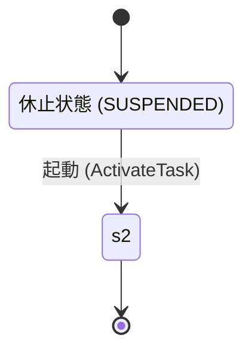
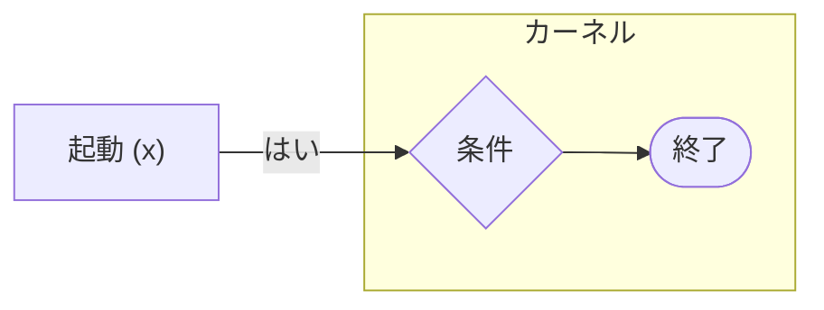
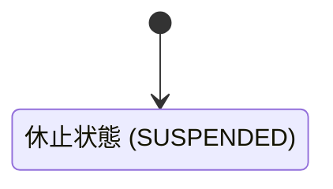

# スクリプトの仕様

スキルが実行するスクリプト `revdoc.py` の入出力と判定の決まりを書く。自動テスト（[要件と受入条件](requirements/specification.md) の A）と実装は、この文書に従う。

- 用語は、要件の文書の1章と同じである。この文書だけで使う言葉は、最初に使う節で決める。Markdown の読み方の言葉は、5.1 の表にまとめる。
- 「SR-」は要件の ID、「P-」は禁止事項の ID である。考え方と理由は [プラグインの設計](design.md) に書く。
- この文書の値（行数、割合、回数）は、スクリプトの1か所に定数で置く。
- 表の中の `\|` は、`|` の1文字を表す（Markdown の表の中で `|` を書くための書き方である）。

全体は次の順に書く。

| 章 | 内容 |
| --- | --- |
| 1 | 共通の決まり（呼び方、標準出力、エラー、ファイル、禁止事項） |
| 2 | 計画（対象のソースファイル、ユニット、モジュール、PDF、仕事、計画のファイル） |
| 3、4 | `init` と `next`（結果、段階、仕事の状態、やり直し、状態のファイル） |
| 5 | Markdown の読み方と、共通の検査 |
| 6 | 仕事の種類ごとの出力の形式と合格の条件 |
| 7 | 指示のファイルとひな形 |
| 8 | スクリプトだけの処理（組み立て、振り分け、検証の繰り返し、要約、仕上げ） |
| 9 〜 11 | `check`、`mkdocs.yml`、`serve` と `stop` |
| 12 | テストのための入口 |

## 1. 共通の決まり

### 1.1 置き場所と呼び方

- 入口は `plugin/skills/make-design-docs/scripts/revdoc.py`。本体は同じフォルダの `revdoclib/` パッケージに置く。
- 呼び方は `<python> '<revdoc.py の絶対パス>' <サブコマンド> --out '<出力先>' …` の1行である。
- サブコマンドは `init`、`next`、`check`、`serve`、`stop` の5つ。`--out` を省いたときは、カレントフォルダの `design-docs` を出力先にする。
- `revdoc.py` は、次の順に行う：`sys.dont_write_bytecode = True` にする。実行のたびに `sys.version_info` を読み、3.9 未満なら `python_too_old` を返す。自分のフォルダを `sys.path` に足して `revdoclib` を読み込み、`revdoclib.main(sys.argv[1:])` の戻り値で終わる。
- `revdoc.py` は、古い Python でも構文エラーにならない書き方にする（f 文字列と型の注釈を使わない）。
- 使うパッケージは、pypdfium2（5 以上）、Pillow、mkdocs-material。pypdfium2 と Pillow は、`--pdf` があるときだけ使う。
- スクリプトがほかのプログラム（mkdocs、自分自身）を動かすときは、`sys.executable` を使う。

### 1.2 標準出力と終了コード

- 標準出力には、JSON のオブジェクト1つを1行で書く。作り方は `json.dumps(値, ensure_ascii=True, separators=(",", ":"))` と改行1つである。
- 成功は `"ok": true` と終了コード 0。失敗は次の形と終了コード 1。

```json
{"ok":false,"error":"no_input","message":"<日本語の説明>","do":"<英語の文>"}
```

- 引数の誤りと、予期しない例外も、この形で返す（`bad_arguments`、`internal_error`）。
- JSON の中のパスは、`out` などの絶対パスを OS の書き方で、出力先からの相対パスを `/` 区切りで書く。

### 1.3 エラーの一覧

| `error` | 起きる条件 | サブコマンド |
| --- | --- | --- |
| `python_too_old` | Python が 3.9 未満。 | すべて |
| `bad_arguments` | 知らないサブコマンドかオプション。値のないオプション。 | すべて |
| `bad_path` | `--out`、`--src`、`--pdf` の絶対パスに `'` がある。 | `init` |
| `no_input` | `--src` と `--pdf` の両方がない。 | `init` |
| `src_not_found` | `--src` がフォルダでない。 | `init` |
| `pdf_not_found` | `--pdf` が、フォルダでも `.pdf` のファイルでもない。 | `init` |
| `missing_packages` | 使うパッケージが足りない。結果に `packages`（pip に渡す名前の配列）を持つ。 | `init` |
| `no_pdf_files` | `--pdf` のフォルダに PDF が1つもない。 | `init` |
| `pdf_unreadable` | 開けない PDF か、0 ページの PDF がある。`message` にファイル名を書く。 | `init` |
| `no_source_files` | `--src` に対象のソースファイルが1つもない。 | `init` |
| `path_too_long` | Windows で、作るファイルのパスが長すぎる（下の決まり）。`message` に、出力先を短いパスにしてやり直すと書く。 | `init` |
| `input_changed` | 状態があり、作り直した計画が、保存した計画と違う（3章の 4）。`message` に、違いのあるファイルの相対パスを、文字の順に5件までと、全部の件数を書く。`mode`、`src`、`pdf` が違うときは、その旨を書く。 | `init` |
| `not_initialized` | `.work/state.json` がない。 | `next`、`check`、`serve` |
| `no_output` | 4.6 の条件。 | `next` |
| `not_done` | 段階が `done` でない。 | `serve` |
| `serve_failed` | ビルドかサーバーが失敗で終わった。使えるポートがない。結果に `log`（ログの最後の 20 行の配列）を持つ。 | `serve` |
| `internal_error` | 予期しない例外。`message` に例外の種類と文を書く。 | すべて |

`init` は、この表の `init` の行を上から順に確かめ、最初に当たったものを返す。

`path_too_long` は、Windows（`os.name == "nt"`）のときだけ調べる。出力先の絶対パスに、次のうち長い方を足した長さが 247 文字を超えるときに当たる。部分も対象のソースファイルもないときは、調べない。

- `.work/rejected/<仕事の ID>-2/docs/requirements/3-1-functions/<いちばん長い部分の名前>.md`
- `.work/src-utf8/<いちばん長い相対パス>`

### 1.4 ファイルの読み書き

- 書き込むのは、出力先の中だけとする。作業フォルダは `<出力先>/.work/`。以下の `.work/` と `docs/` は、出力先からの相対パスである。
- ファイルは、UTF-8（BOM なし）、改行 `\n` で書く。`open()` には、いつも文字コードを指定する。出力先の中のファイルを読むときは、先頭の BOM と、行末の `\r` を外す。
- 行は `\n` で区切る。最後が `\n` で終わるときは、その後ろの空の行を数えない。
- 並び順の「文字の順」は、Unicode のコードポイントの順（Python の文字列の比較）である。
- `.work/state.json` と `.work/serve.json` を書くときは、`<ファイル名>.tmp` に書いてから `os.replace` で置き換える。残っている `.tmp` は読まない。設計書を書き換えるときも、`<ファイル名>.tmp` に書いてから置き換える。
- ファイルの置き換え、移動、削除は、1つの関数で行う。`PermissionError` のときは、0.1 秒おきに 10 回までやり直す。
- 同じ入力と同じ担当エージェントの出力からは、同じファイルを作る。時刻と乱数を、計画、指示のファイル、設計書に書かない。

作業フォルダの中身は次のとおり。

| パス | 中身 | 作るとき |
| --- | --- | --- |
| `.work/plan.json` | 計画（2.8） | `init` |
| `.work/state.json` | 状態（4.7） | `init`、`next` |
| `.work/names.txt` | 名前の集まり（2.9） | `init` |
| `.work/modules.md` | モジュールの一覧（2.4） | `init` |
| `.work/src-utf8/<相対パス>` | UTF-8 に直したコピー（2.2） | `init` |
| `.work/jobs/<仕事の ID>.md`、`.files.md` | 指示のファイル（7章） | `next` |
| `.work/memo/<ユニットの ID>.md` | 解析メモ | 解析担当 |
| `.work/pdf/<PDF の ID>/<ページ>.png`、`.txt`、`.json` | ページの画像と埋め込みテキスト（6.2） | `next` |
| `.work/pdf/<PDF の ID>/<ページ>.md` | ページごとの Markdown | 変換担当 |
| `.work/match/<仕事の ID>.lines.md`、`.json` | 番号を振った行（5.6） | `next` |
| `.work/match/<仕事の ID>.md` | 照合の記録 | 照合担当 |
| `.work/records/<仕事の ID>.md`、`<仕事の ID>.legacy.md`、`overall.md`、`records.json` | 振り分けた照合の記録（8.3） | `next` |
| `.work/unknowns/<仕事の ID>.md` | 執筆担当が書く不明点 | 執筆担当 |
| `.work/templates/<ファイル名>` | 決まった1文（2.8）を入れた、設計書のひな形（7.3） | `init` |
| `.work/verify/<仕事の ID>.lines.md`、`.json` | 番号を振った行（5.6） | `next` |
| `.work/verify/<仕事の ID>.md` | 判定の記録 | 検証担当 |
| `.work/digest.md` | 要約（8.6） | `next` |
| `.work/rejected/<仕事の ID>-<回数>/…` | 不合格だった出力（4.5） | `next` |
| `.work/serve.json`、`serve.log` | サーバーの状態とログ（11章） | `serve` |
| `.work/privacy/` | `privacy` プラグインのキャッシュ（10章） | `serve` |

`mode` が `pdf` のとき、`init` は `names.txt`、`modules.md`、`src-utf8/`、`templates/` を作らない。

ページは4桁（`0001`）、仕事の ID は `J` と5桁（`J00001`）、ユニットの ID は `U` と4桁、PDF の ID は `D` と2桁で書く。桁が足りないときは、桁を増やす。

### 1.5 `do` の文

`init`、`next`、`serve` の結果と、すべてのエラーは、`do` を持つ。`do` は、次の表の英語の文である。

- `<python>` は、Windows（`os.name == "nt"`）では、`py` が見つかれば `py -3`、なければ `python`。それ以外では、`python3` が見つかれば `python3`、なければ `python`。見つかるかは `shutil.which` で調べる。
- `CMD(x)` は、`<python> '<revdoc.py の絶対パス>' x --out '<出力先の絶対パス>'` である。

| 場面 | `do` |
| --- | --- |
| `init` の成功 | `Run: CMD(next)` |
| `next` で `jobs` がある | `Start one foreground subagent per job in a single message: type = the job's agent, prompt = "Read the file OUT/FILE and follow it." (OUT: the --out folder below, FILE: the job's file). When all of them have returned, run: CMD(next)` |
| `next` で `state` が `done` | `All jobs are finished. Run: CMD(serve)` |
| `serve` で `state` が `serving` | `Tell the user in Japanese: the site URL (url), the folder of the documents (docs), the two review lists (discrepancies, unknowns), the counts (counts) and the number of failed jobs (failed_jobs). To stop the server, run: CMD(stop)` |
| `serve` で `state` が `building` | `The site is not ready yet. Run the same command again: CMD(serve)` |
| `missing_packages` | `Tell the user in Japanese that these Python packages are missing and that they should run this themselves: <python> -m pip install <名前>. Then stop. Running the same skill command again starts the work.`。`<名前>` は、名前を1つずつ二重引用符で囲み、空白でつないだものである（例：`"pypdfium2>=5" "Pillow"`）。 |
| `no_output` | `Tell the user in Japanese that the subagents wrote no files and that they should check that subagents can write files in the output folder. Then stop. Running the same skill command again resumes the work.` |
| `input_changed` | `Tell the user in Japanese what the message says and that they can either restore the input and run the same skill command again, or choose a new output folder to start over. Then stop.` |
| そのほかのエラー | `Tell the user in Japanese what the message says. Then stop.` |

### 1.6 禁止事項

- 入力（ソースコード、PDF）を書き換えること（P-01）。
- 出力先の外にファイルを書くこと（P-02）。
- 標準出力に、JSON のほかの文字を書くこと。
- 利用者が変える設定（この文書にないオプション、環境変数、設定ファイル）を持つこと。
- 文字コードを指定せずにファイルを開くこと。
- 時刻、乱数、辞書の並びの違いで、計画、仕事の順番、指示のファイルの内容が変わること。

## 2. 計画

`init` は、入力から計画を作る。同じ入力からは、Linux でも Windows でも、同じ計画になる（SR-19）。

### 2.1 対象のソースファイル

`--src` のフォルダを再帰的に調べる。次の表を上から順に当て、最初に当たった理由で外す。どれにも当たらないファイルが、対象のソースファイルである。

| 順 | 外すもの | `excluded` の `reason` |
| --- | --- | --- |
| 1 | 名前が `.git`、`.svn`、`.hg` のフォルダの中。出力先の中。 | 載せない |
| 2 | シンボリックリンク（ファイルもフォルダも）。 | `symlink` |
| 3 | 拡張子（小文字にして比べる）が `md`、`markdown`、`txt`、`rst`、`adoc`、`html`、`htm`、`csv`、`tsv`、`log`、`svg`、`map`、`lst`、`dep`、`su`、`hex`、`srec`、`s19`、`mot`、`pdf` のどれか。 | `extension` |
| 4 | 大きさが 0 バイト。 | `empty` |
| 5 | 先頭の2バイトが `FF FE` か `FE FF` である（UTF-16 の BOM）。 | `utf16` |
| 6 | 先頭の 8,192 バイトに NUL（0x00）がある。 | `binary` |
| 7 | 大きさが 2,097,152 バイトを超える。 | `too_large` |
| 8 | UTF-8 に直した内容（2.2）に、102,400 バイトを超える行がある。数え方は、2.3 の 2 のとおり。 | `long_line` |

- ファイルのパスは、`--src` からの相対パスを `/` 区切りで書く。以下の「相対パス」は、これを指す。
- 行数は、1.4 の行の数え方で数える。

### 2.2 文字コード

- 2.1 の順7までに外れなかったファイルごとに、`utf-8`、`euc_jp`、`cp932` の順に、エラーなしで読めるかを試す。最初に読めたものを、そのファイルの文字コードにする。どれでも読めないときは `latin-1` にする。
- 先頭の BOM は、UTF-8 として読み、内容から外す。
- 文字コードが `utf-8` でないファイルは、UTF-8 に直したコピーを `.work/src-utf8/<相対パス>` に作る。改行は元のままにする。行番号は、元のファイルと同じになる。
- 以下の「ソースファイルの内容」は、UTF-8 に直した内容を指す。担当エージェントに読ませるパスは、コピーがあるファイルではコピーの絶対パス、ないファイルでは元の絶対パスである。

### 2.3 ユニット

1. 対象のファイルを、（フォルダの相対パス、ファイル名）の組の、文字の順に並べる。`--src` の直下のフォルダの相対パスは、空の文字列とする。
2. 上限を、2,000 行と 102,400 バイトとする。行のバイト数は、UTF-8 に直した内容の1行の、行末の `\n` と `\r` を含むバイト数である。最後の行に `\n` がないときは、ある分だけ数える。
3. 上限の両方に収まるファイルは、そのまま1つの範囲（1行目から最後の行）にする。
4. どちらかを超えるファイルは、先頭から、上限に収まる最大の行数ずつに分ける。分けた1つずつが範囲である。
5. フォルダごとに、範囲を順に足していく。足すと上限のどちらかを超えるときは、そこでユニットを閉じ、次のユニットを始める。フォルダが変わるときも閉じる。
6. ユニットの ID は、できた順に `U0001`、`U0002`、…とする。

境界の例：2,000 行のファイルは1つの範囲になる。2,001 行のファイルは、1〜2,000 行と 2,001〜2,001 行の2つの範囲になる。合計がちょうど 2,000 行になる範囲は、同じユニットに入る。改行を含めて 102,400 バイトの行は、1行で1つの範囲になる。102,401 バイトの行があるファイルは、`long_line` で外れる。

### 2.4 モジュールと名前

対象のファイルを直接含むフォルダ1つが、1モジュールである。並び順は、フォルダの相対パスの文字の順とする。

モジュールの名前は、次の順に決める。名前は、設計書のファイルのパス、照合の記録、一覧で使う。

1. フォルダの相対パスを `/` で分ける。直下のフォルダは `_root` の1つとする。
2. 分けた1つずつで、ASCII の英数字、`.`、`_`、`-`、ASCII でない文字のほかを、`_` に置き換える。先頭が `.` のときは、その `.` を `_` に置き換える。
3. 最後の1つが、小文字にして `analysis`、`report`、`summary`、`findings` のどれかで始まるときは、先頭に `m-` を付ける。
4. `/` でつなぐ。小文字にして比べ、すでに決めたモジュールの名前か部分の名前と同じなら、最後に `-2` を付ける。まだ同じなら `-3`、`-4`、…と変える。名前は、モジュールの順に決める。モジュールの名前を決めた直後に、その部分の名前を決める。

ユニットが5個を超えるモジュールは、ユニットの順に5個ずつの「部分」に分ける。部分の名前は `<モジュールの名前>/<1 からの番号>` とし、4 の決まりで重なりを調べる。分けないモジュールは、部分が1つで、部分の名前はモジュールの名前と同じである。

| 入力のフォルダ | 名前 |
| --- | --- |
| `kernel` | `kernel` |
| （直下） | `_root` |
| `tools/report` | `tools/m-report` |
| `Summary` | `m-Summary` |
| `Kernel` と `kernel`（この順に並ぶ） | `Kernel` と `kernel-2` |
| `.github/workflows` | `_github/workflows` |
| `my lib` | `my_lib` |
| ユニットが 12 個の `kernel` | 部分は `kernel/1`、`kernel/2`、`kernel/3`（5個、5個、2個） |
| ユニットが 12 個の `kernel` と、フォルダ `kernel/1` | `kernel`（部分は上の行と同じ）と `kernel/1-2` |

機能の要求の ID の接頭辞は、部分ごとに次の順に決める。

1. モジュールの名前を大文字にし、`A`〜`Z` と `0`〜`9` のほかの文字の並びを `-` 1つに置き換え、両端の `-` を取る。空になったときは、`M` と、モジュールの順番（1 から、3桁）にする。
2. 分けたモジュールの部分には、後ろに `-P<部分の番号>` を付ける。
3. 接頭辞は `FR-<1、2 の結果>-` とする。すでに使われた接頭辞と同じなら、最後の `-` の前に `-2`、`-3`、…を付ける。

例：`kernel` は `FR-KERNEL-`。`arch/v850_gcc` は `FR-ARCH-V850-GCC-`。`_root` は `FR-ROOT-`。`kernel/2` は `FR-KERNEL-P2-`。

`.work/modules.md` には、モジュールごとに `- <名前>（フォルダ：<相対パス。直下は 直下>、<ファイルの数> ファイル、<行数> 行）` の1行を、モジュールの順に書く。

### 2.5 PDF

- `--pdf` がフォルダのときは、再帰的に、拡張子が `pdf`（大文字と小文字を区別しない）のファイルを探す。`--pdf` からの相対パスの文字の順に並べる。ファイルのときは、その1つを使う。
- PDF の ID は、並び順に `D01`、`D02`、…とする。
- PDF の名前は、拡張子を含むファイル名とする（例：`ATK2_spec.pdf`）。一覧と指示のファイルで使う。
- `docs/legacy/` の下のフォルダ名は、拡張子を除いたファイル名に、2.4 の 2 〜 4 を当てたものとする。重なりは、PDF のフォルダ名どうしで調べる。
- PDF ごとに、次を決めて計画に書く。
  - `pages`：ページの数。
  - `text_check`：埋め込みテキストを検査に使うか。全部のページの文字の数（`FPDFText_CountChars`）の合計を T、そのうち `FPDFText_HasUnicodeMapError` が 1 の文字の数を E とする。T が 0 のときと、E ÷ T が 0.05 を超えるときは `false`。それ以外は `true`（SR-37）。
  - `margins`：ヘッダーとフッターの文字列（2.6）。

### 2.6 ヘッダーとフッター

ページの位置は、左上を原点にし、幅と高さに対する割合を 10,000 倍して四捨五入した整数で持つ（0 〜 10000）。

- **テキストの単位**：pypdfium2 の `PdfTextPage.count_rects()` と `get_rect(i)` で得る矩形1つと、`get_text_bounded()` でその矩形から取り出した文字列。矩形は `[x0, y0, x1, y1]`（左、上、右、下）で持つ。順番は `i` の順とする。
- **端の単位**：次のどれかに当たる単位。上から順に調べ、最初に当たったものを `side` にする。`top`：y1 ≤ 1000。`bottom`：y0 ≥ 9000。`left`：x1 ≤ 1000。`right`：x0 ≥ 9000。
- **キー**：単位の文字列を NFKC で正規化し、数字（`0`〜`9`）と空白を取り除いたもの。数字だけの文字列のキーは、空の文字列になる。
- **高さ**：`(y0 + y1) // 2`。

ページが4以上の PDF で、次のように決める。3ページ以下の PDF の `margins` は空にする。

1. 全部のページの端の単位を、キーごとに集める。
2. キーごとに、高さの小さい順（同じなら、ページ、`i` の順）に並べる。先頭の高さを h とし、高さが h + 100 以下の単位を1つの組にする。残りで同じことを繰り返す。
3. 組の単位があるページの数が、全部のページの数の半分以上（`ページの数 × 2 ≥ 全部のページの数`）の組を、ヘッダーとフッターの文字列とする。
4. `margins` に、組ごとに `{"key": <キー>, "side": <最初の単位の side>, "y": <h>, "text": <ページがいちばん小さい単位の文字列>}` を書く。順番は、`side`（`top`、`bottom`、`left`、`right` の順）、`y`、`key` の順とする。

あるページの単位は、端の単位であり、キーが同じで、高さが `y` 以上 `y + 100` 以下の `margins` の項目があるとき、「余白の単位」である。

**行の先頭の行番号**（SR-34）：全部の行の先頭に行番号がある PDF（テキストのファイルを印刷したものなど）は、次のように扱う。

- ページの埋め込みテキスト（`PdfTextPage.get_text_range()` の全体。`\r\n` は `\n` にする）を、行に分ける。正規表現 `^\s*([0-9]+)(\s|$)` に当たる行を、番号つきの行とする。
- 番号つきの行が5行以上あり、空でない行の8割以上を占め、番号が、番号つきの行の順に1ずつ増えるページを、行番号のあるページとする。
- 行番号のあるページが、全部のページの半分以上のとき、計画の `line_numbers` を `true` にする。それ以外は `false`。
- `line_numbers` が `true` の PDF の、行番号のあるページでは、6.2 の準備で、行番号を除く。
  - `<ページ>.txt`：番号つきの行から、正規表現 `^\s*[0-9]+ ?` に当たる部分を除く。
  - `<ページ>.json` の `units`：番号つきの行の番号ごとに、順に、前の番号で選んだ単位より後ろの単位のうち、文字列が番号で始まる（正規表現 `^\s*<番号>(\s|$)` に当たる）最初の単位を選び、その文字列から、先頭の番号と、その後ろの空白1つを除く。番号が、続いた2つ以上の単位に分かれているとき（前後の空白を除いた文字列をつなぐと、番号になるとき）は、その単位の並びを選び、番号の分の文字と、その後ろの空白1つを除く。当たる単位がない番号は、飛ばす。余白の単位かどうかは、除く前の文字列で決める。

### 2.7 仕事

`init` は、次の順に仕事を作り、ID を `J00001` から順に付ける。照合と検証の仕事は、`next` が後から作り、続きの番号を付ける（8.2、8.5）。

| 順 | 種類（`kind`） | 作る単位 | `target` | 作る条件 |
| --- | --- | --- | --- | --- |
| 1 | `analyze` | ユニットごと（ユニットの順） | ユニットの ID | `--src` がある |
| 2 | `convert` | PDF ごとに、1ページ目から 10 ページずつ（PDF の順、ページの順）。最後は 10 ページ未満でもよい。 | `<PDF の ID>:<最初のページ>-<最後のページ>` | `--pdf` がある |
| 3 | `write_module` | 部分ごと（モジュールの順、部分の順） | 部分の名前 | `--src` がある |
| 4 | `write_overall` | 6.5 の表のファイルごと（表の順） | `docs/` からのファイルのパス | `--src` がある |

### 2.8 計画のファイル

`.work/plan.json` に、次の形で書く。`init` の後は書き換えない。

```json
{
  "version": 1,
  "mode": "both",
  "src": "/abs/src",
  "pdf": "/abs/pdf",
  "none_sentence": "ソースコードと既存の設計書から読み取れる内容はない。",
  "files": [
    {"path": "kernel/task.c", "sha1": "3f2a…", "lines": 812, "bytes": 20480, "encoding": "utf-8"}
  ],
  "excluded": [{"path": "doc/readme.txt", "reason": "extension"}],
  "units": [
    {"id": "U0001", "module": "kernel", "lines": 1650, "bytes": 51000,
     "files": [{"path": "kernel/task.c", "start": 1, "end": 812},
               {"path": "kernel/task.h", "start": 1, "end": 838}]}
  ],
  "modules": [
    {"name": "kernel", "folder": "kernel", "files": 2, "lines": 1650,
     "parts": [{"name": "kernel", "units": ["U0001"], "fr_prefix": "FR-KERNEL-"}]}
  ],
  "pdfs": [
    {"id": "D01", "path": "ATK2_spec.pdf", "name": "ATK2_spec.pdf", "folder": "ATK2_spec",
     "sha1": "9c1b…", "pages": 25, "text_check": true, "line_numbers": false,
     "margins": [{"key": "文書番号", "side": "top", "y": 590, "text": "文書番号"}]}
  ],
  "jobs": [
    {"id": "J00001", "kind": "analyze", "target": "U0001"},
    {"id": "J00002", "kind": "convert", "target": "D01:1-10"},
    {"id": "J00003", "kind": "convert", "target": "D01:11-20"},
    {"id": "J00004", "kind": "convert", "target": "D01:21-25"},
    {"id": "J00005", "kind": "write_module", "target": "kernel"},
    {"id": "J00006", "kind": "write_overall", "target": "design/architecture.md"},
    {"id": "J00007", "kind": "write_overall", "target": "requirements/1-introduction.md"}
  ]
}
```

| キー | 意味 |
| --- | --- |
| `mode` | `both`（ソースコードと PDF）、`source`（ソースコードだけ）、`pdf`（PDF だけ）。 |
| `src`、`pdf` | 入力の絶対パス。ないものは `null`。 |
| `none_sentence` | 決まった1文。`both` は `ソースコードと既存の設計書から読み取れる内容はない。`、`source` は `ソースコードから読み取れる内容はない。`、`pdf` は `null`。 |
| `files` | 対象のソースファイル。2.3 の 1 の順。`sha1` は元のファイルのバイト列の SHA-1、`bytes` は UTF-8 に直した後のバイト数。 |
| `excluded` | 外したファイル。相対パスの文字の順。 |
| `units`、`modules`、`pdfs`、`jobs` | 2.3 〜 2.7 のとおり。`units` の `bytes` は、範囲の行のバイト数（2.3 の 2）の合計。`modules` の `folder` は相対パスで、直下は空の文字列。`pdfs` の `path` は `--pdf` からの相対パス（ファイルを指定したときはファイル名）。 |

上の例は、`files` の2つ目と、`write_overall` の3件目から後ろ（`J00008` 〜 `J00017`）を省いている。

`mode` が `source` のとき `pdfs` は空の配列、`pdf` のとき `files`、`excluded`、`units`、`modules` は空の配列である。

### 2.9 名前の集まり

- 5.1 の「語」を、全部の対象のソースファイルの内容と、その相対パスから集める。
- 重なりを除き、文字の順に、1行に1つずつ `.work/names.txt` に書く。

## 3. `init`

```
<python> '<revdoc.py>' init --out '<出力先>' [--src '<フォルダ>'] [--pdf '<フォルダか PDF のファイル>']
```

1. 1.3 の順に入力を確かめる。足りないパッケージは `revdoclib.packages.missing(need_pdf)` で調べる（12章）。
2. 計画を作る（2章）。`path_too_long` を確かめる（1.3）。
3. `.work/state.json` がないとき：`.work/` の表の「`init`」のファイルと、最初の状態（4.7）を書く。最初の状態は、`stage` が最初の仕事の種類（`analyze` か `convert`）、`round` と `no_output` が 0、`next_job` が仕事の数 + 1、`confirmed` が `{}`、`log` が `[]` である。`jobs` には計画の仕事を順に全部入れ、`stage` と `agent` を 4.2 の表のとおり、`status` を `pending`、`tries` を 0、`reasons` と `substitute` を `[]`、`outputs` を6章のその仕事の出力の全部にする。`convert` の `pages` は、仕事の全部のページを `{"prev": [], "mermaid": false}` にする。
4. `.work/state.json` があるとき（再開）：作った計画と `.work/plan.json` を、`excluded` を除いて、JSON の値として比べる。違えば `input_changed`。同じなら、`issued` の仕事を `pending` に戻し、`no_output` の回数を 0 にする。仕事の回数（`tries`）は変えない。

「違いのあるファイル」は、2つの計画の `files` と `pdfs` で、片方にしかないパスと、`sha1` が違うパスである。

成功したときの結果：

```json
{"ok":true,"do":"Run: python3 '/abs/plugin/skills/make-design-docs/scripts/revdoc.py' next --out '/abs/design-docs'"}
```

## 4. `next`

```
<python> '<revdoc.py>' next --out '<出力先>'
```

### 4.1 結果

```json
{"ok":true,"state":"running",
 "jobs":[{"agent":"reverse:pdf-converter","file":".work/jobs/J00013.md"}],
 "do":"Start one foreground subagent per job in a single message: …"}
```

| キー | 意味 |
| --- | --- |
| `state` | `running`（仕事がある）か `done`（全部終わった）。 |
| `jobs` | 渡す仕事。0 〜 4 件。ID の小さい順。 |
| `jobs[].agent` | 担当エージェントの名前（4.2 の表）。 |
| `jobs[].file` | 指示のファイル。出力先からの相対パス。 |

`state` が `done` のときは、次の形で返す。何度呼んでも、同じ結果を返す。

```json
{"ok":true,"state":"done","jobs":[],
 "do":"All jobs are finished. Run: python3 '/abs/…/revdoc.py' serve --out '/abs/design-docs'"}
```

出力先の絶対パスと `revdoc.py` の絶対パスが、JSON に書いた長さ（1.2 の作り方。前後の `"` を除く）でそれぞれ 100 バイト以下のとき、`next` の成功の結果は 1,000 バイト以下になる（A-4）。実行のときは、長さで止めない。

### 4.2 段階

段階は、次の表の順に進む。`mode` に合わない段階と、仕事が0件の段階は飛ばす。1回の `next` が返す仕事は、1つの段階のものだけである。

| 段階（`stage`） | 仕事の種類 | 担当エージェント | 行う `mode` | 段階に入るときの処理 | 段階が終わったときの処理 |
| --- | --- | --- | --- | --- | --- |
| `analyze` | `analyze` | `reverse:code-analyst` | `both`、`source` | なし | なし |
| `convert` | `convert` | `reverse:pdf-converter` | `both`、`pdf` | なし | 既存の設計書の組み立て（8.1） |
| `match` | `match` | `reverse:doc-matcher` | `both` | 照合の仕事を作る（8.2） | 照合の記録の振り分け（8.3） |
| `write_module` | `write_module` | `reverse:doc-writer` | `both`、`source` | なし | なし |
| `verify_module` | `verify` | `reverse:doc-verifier` | `both`、`source` | `round` を 1 にして、検証の仕事を作る（8.5） | 要約（8.6） |
| `write_overall` | `write_overall` | `reverse:doc-writer` | `both`、`source` | なし | なし |
| `verify_overall` | `verify` | `reverse:doc-verifier` | `both`、`source` | `round` を 1 にして、検証の仕事を作る（8.5） | なし |
| `done` | — | — | すべて | — | — |

- 「処理」は、どれもスクリプトだけで行う。段階に入るときの処理の後に、仕事が0件なら、段階が終わったときの処理を行って、次の段階へ進む。
- 最後の段階が終わったら、仕上げ（8.7）を行い、`done` にする。
- `write_module` と `write_overall` の仕事が `done` か `failed` になったときに、「既存設計書のみ」の記録を差し込む（8.4）。
- 検証の段階は、8.5 の繰り返しが終わったときに終わる。

### 4.3 仕事の状態

| 状態（`status`） | 意味 |
| --- | --- |
| `pending` | まだ渡していない。または、渡し直しを待っている。 |
| `issued` | 渡した。出力を待っている。 |
| `done` | 済み。 |
| `failed` | 失敗。 |

```
pending → issued → done
             ├──→ pending（不合格。回数を1増やす。3回目は failed）
             └──→ failed
```

`done` と `failed` の仕事は、やり直さない。

### 4.4 1回の `next` の手順

1. 状態を読む。段階が `done` なら、4.1 の `done` の結果を返す。
2. `issued` の仕事があれば、出力を調べる（4.5、4.6）。4.6 の表の 1 のときは、ここで結果を返す。
3. 今の段階に `pending` の仕事があれば、ID の小さい順に最大4件を渡し、結果を返す。
4. なければ、段階が終わったときの処理を行い、次の段階に入るときの処理を行って、3 に戻る。

仕事を渡すときは、次の順に行う。

1. `outputs` のファイルが残っていれば消す。
2. `outputs` の親フォルダを作る。
3. `convert` では、ページの画像と埋め込みテキストを作る（6.2）。
4. 指示のファイルを書く（7章）。
5. 状態を `issued` にして保存する。

### 4.5 不合格と失敗

`issued` の仕事の検査は、全部の仕事の検査を終えてから、ファイルを動かす。`verify` の仕事は、8.5 の決まりで扱う。

1. 仕事ごとに、6章の検査を行い、不合格の項目の一覧を作る。`outputs` のファイルがないことは、`missing_file` の不合格である。
2. 項目が0件の仕事は `done` にする。
3. 項目がある仕事は、回数（`tries`）を1増やす。
   - 回数が1か2のとき：不合格の項目があるファイルを `.work/rejected/<仕事の ID>-<回数>/<出力先からの相対パス>` に移す。`outputs` を、移したファイルと、なかったファイルだけにする。項目を `reasons` に入れ、`pending` に戻す。
   - 回数が3のとき：`failed` にする。あるファイルは、そのまま残す。ないファイルには、代わりのファイル（下の表）を置き、`substitute` に入れる。項目を `reasons` に入れる。

| 種類 | 代わりのファイルの中身 |
| --- | --- |
| `analyze` | `# <ユニットの ID>`、空行、`解析できなかった。ソースコードを直接読む。`、空行、ユニットのファイルごとの `- <相対パス>（<開始行>-<終了行> 行）`。 |
| `convert` | ページごとに、`## 変換できなかったページ`、空行、``、空行、`図の説明：このページは変換できなかった。ページの全体を画像で載せる。`。 |
| `match` | `## 1-<行の数> 照合していない` の1行。 |
| `write_module` の内部設計書 | `# <部分の名前>`、空行、`この設計書は作れなかった。ソースコードを直接読む。`、空行、部分のソースファイルごとの `- <相対パス>`。 |
| `write_module` の機能の要求 | `# 3.1 機能（<部分の名前>）`、空行、`この文書は作れなかった。` |
| `write_overall` | `.work/templates/` の、そのファイルのひな形と同じ内容。 |
| 不明点のファイル | `- なし` の1行。 |
| `verify` | 置かない。その仕事の行は、次の回の対象になる（8.5）。 |

種類ごとの例外は次のとおり。

- `analyze`：回数が3になる検査で、項目が `too_long` だけのときは、`done` にする。
- `convert`：ページごとに合否を決める。6.2 の決まりで、文字列の指摘だけが残ったページは合格にする。

### 4.6 出力がない回

「出力がない仕事」は、`outputs` のファイルが1つもない仕事である。

`issued` の仕事の全部が、出力がない仕事のときは、中断とみなす。状態の `no_output`（続いた回数）を1増やし、次のようにする。

| `no_output` | 行うこと |
| --- | --- |
| 1 | 仕事の状態（`issued`）も回数も指示のファイルも変えずに、同じ仕事を、もう一度返す。結果は、ふつうの `running` である。 |
| 2 | `issued` の仕事の回数を1ずつ増やし、出力のファイルごとに `missing_file` を `reasons` に入れる（`verify` の仕事も同じ）。回数が3になった仕事は、4.5 のとおり `failed` にする。残りは `pending` に戻す。`no_output` を 0 にして保存し、エラー `no_output` を返す。 |

- 1件でも出力がある回は、`no_output` を 0 にし、4.5 のとおりに調べる。出力がない仕事は、`missing_file` の不合格になる。
- この決まりは、`issued` の仕事が1件だけの回にも、同じように当てる。その仕事が毎回書けないときは、`no_output` で3回止まった後に `failed` になり、先へ進む。

### 4.7 状態のファイル

`.work/state.json` の形は次のとおり。

```json
{
  "version": 1,
  "stage": "verify_overall",
  "round": 1,
  "no_output": 0,
  "next_job": 70,
  "jobs": [
    {"id": "J00013", "kind": "convert", "stage": "convert", "target": "D01:1-10",
     "agent": "reverse:pdf-converter", "status": "failed", "tries": 3,
     "outputs": [".work/pdf/D01/0003.md"],
     "reasons": [{"rule": "bad_table", "file": ".work/pdf/D01/0003.md", "line": 12, "detail": "列の数が違う"}],
     "substitute": [],
     "pages": {"3": {"prev": ["missing:タスクの状態"], "mermaid": false}}}
  ],
  "confirmed": {"docs/design/modules/kernel.md": ["5d41402a…"]},
  "log": [
    {"type": "convert_diff", "pdf": "D01", "page": 4, "kind": "extra", "text": "続き"},
    {"type": "figure_switched", "pdf": "D01", "page": 7},
    {"type": "verify_unknown", "file": "docs/design/modules/kernel.md", "heading": "## 状態", "text": "- …", "words": "MAX_RETRY"},
    {"type": "verify_unjudged", "file": "docs/design/modules/kernel.md", "heading": "## 状態", "text": "- …"},
    {"type": "input_diff", "path": "kernel/task.c"}
  ]
}
```

例は、解析 12 件、変換3件（25 ページ）、執筆（モジュール）4件、執筆（全体）12 件の計画で、検証（全体）の1回目まで進んだ状態である。

| キー | 意味 |
| --- | --- |
| `stage` | 今の段階。 |
| `round` | 検証の繰り返しの回（1 〜 3）。検証の段階でないときは 0。 |
| `no_output` | 4.6 の回数。 |
| `next_job` | 次に作る仕事の番号。 |
| `jobs` | 全部の仕事。ID の順。`outputs` は、担当エージェントがその回に書くファイルで、検査が見るファイルである（出力先からの相対パス）。`tries` は、4.5 と 4.6 で増やした回数。`reasons` は、最後の検査の不合格の項目で、`rule`（検査の名前）、`file`、`line`（ないときは `null`）、`detail`（日本語の説明。`bad_mermaid` では 5.4 の番号で始める。例：`F3：…`）を持つ。テストは、`bad_mermaid` のほかの `detail` の中身を確かめない。`verify` の仕事の項目は、`missing_file` のほかは、`n`（番号）と `sha1`（行の SHA-1。8.5）も持つ。`substitute` は、代わりのファイルを置いたパス。 |
| `jobs[].pages` | `convert` だけが持つ。まだ合格していないページごとに、前の回の文字列の指摘（`prev`）と、前の回に `bad_mermaid` があったか（`mermaid`）。 |
| `confirmed` | 検証で確かめた行。設計書のファイルごとに、行の SHA-1（8.5）の配列。重なりは入れない。 |
| `log` | 不明点の一覧に載せる出来事（8.7）。 |

## 5. Markdown の読み方と、共通の検査

### 5.1 Markdown の読み方の言葉

| 言葉 | 意味 |
| --- | --- |
| コードブロック | 行の先頭（空白3つまで）が `` ``` `` の行から、次に `` ``` `` だけの行（前後の空白は除く）までの範囲。閉じる行がないときは、ファイルの最後まで。 |
| コードスパン | コードブロックの外の1行の中で、1つ目と2つ目、3つ目と4つ目、…のバッククォートにはさまれた文字列。対にならない最後のバッククォートの後ろは、コードスパンの外とする。 |
| 見出し | コードブロックの外で、`#` 1〜6個と空白で始まる行。`#` の数がレベルである。 |
| 表 | コードブロックの外で、先頭（空白を除く）が `|` の行が続く範囲。1行目が見出しの行、2行目が区切りの行、3行目からがデータの行である。 |
| 本文の行 | 5.2 のとおり。 |
| 箇条書きの記号 | 行の先頭の、正規表現 `\s*([-*+]\|[0-9]+\.) ` に当たる部分（字下げ、記号、空白1つ）。 |
| 文の先頭 | 行の先頭の空白と、箇条書きの記号を除いた位置。 |
| 語 | ASCII の英数字と `_` が続く、いちばん長い並び（正規表現 `[A-Za-z0-9_]+`）。 |
| 根拠の場所 | 正規表現 `\[(.+?):([0-9]+)-([0-9]+)\]` に、読む位置の先頭で当たる文字列（`[<相対パス>:<開始行>-<終了行>]`）。相対パスは、空白と記号を含んでよい。 |
| 部分 | 2.4 のとおり。 |
| 決まった1文 | 計画の `none_sentence`（2.8）。読み取れる内容がない節に書く。 |
| 印 | `【既存設計書のみ】` と `【判読できない】`。 |

### 5.2 本文の行

コードブロックの外の行は、1行が本文の1行である。次の行は、本文の行に数えない。

- 空行（空白だけの行を含む）
- 見出し
- 行の全体が `<!--` で始まり `-->` で終わる行（ページの目印を含む）
- 表の見出しの行と区切りの行

コードブロックは、Mermaid を含めて、開く行から閉じる行までの全体で、本文の1行と数える。

### 5.3 根拠の場所と、語の検査

根拠の場所は、次のすべてを満たすとき、正しい。満たさないときは `bad_location`。

- 相対パスが、対象のソースファイルのどれかと同じである。
- 1 ≤ 開始行 ≤ 終了行 ≤ そのファイルの行数。
- 解析メモと判定の記録では、終了行 − 開始行 + 1 ≤ 150。解析メモの `## 役割` の節の項目には、この上限を当てない（ファイルの全体を述べる項目のためである）。

語の検査は、文（解析メモの項目、設計書の行）のコードスパンの語を、根拠の場所と照らす。

- 調べる語：文の全部のコードスパンの語。語の直後が `*` のとき（例：`VALVE_*`）は、「その語で始まる語」を探す。
- (a) すべての語が、根拠のファイル（根拠の場所のファイルの全体）の語か、対象のソースファイルの相対パスの語にある。ないときは `unknown_word`。解析メモでは、根拠のファイルの代わりに、名前の集まり（2.9）と照らす（ほかのファイルで定義された名前を書いた項目を、不合格にしないためである）。
- (b) 1つ以上の語が、根拠の場所の行の範囲の語か、根拠のファイルの相対パスの語にある。ないときは `no_word_in_range`。
- 根拠の場所が複数あるときは、ファイルも行の範囲も、合わせたもので調べる。
- コードスパンに語が1つもない文は、(a) も (b) も合格とする。
- 大文字と小文字は区別する。

### 5.4 Mermaid の検査

`` ```mermaid `` で始まるコードブロックの、開く行と閉じる行の間の行を調べる。当たった行ごと、番号ごとに、`bad_mermaid` の項目を1つ作る。`line` は当たった行（M1 から M3 は開く行）とする。検査の関数は1つで、変換、照合、執筆、`check` が使う。

行ごとの検査では、前後の空白を除いた行を使う。空行と、`%%` で始まる行は調べない。M4 と、F、S、Q の検査は、空行と `%%` の行を除いた最初の行より後ろの行に当てる。次の2つを使う。

- Q：行の中の `"…"`（二重引用符から次の二重引用符まで）を、それぞれ `""` に置き換えたもの。
- E：行から、`#`、英数字、`;` の並び（正規表現 `#[A-Za-z0-9]+;`。`#quot;`、`#59;`、`#35;` など）を取り除いたもの。

| 番号 | 対象 | 不合格の条件 |
| --- | --- | --- |
| M1 | すべて | ブロックが閉じていない。 |
| M2 | すべて | 空行と `%%` の行を除いた最初の行が、`stateDiagram-v2`、`sequenceDiagram`、`flowchart TB`、`flowchart TD`、`flowchart BT`、`flowchart LR`、`flowchart RL` のどれでもない。 |
| M3 | すべて | 空行と `%%` の行を除いた最初の行より後ろに、調べる行が1つもない。 |
| M4 | すべて | 二重引用符の数が奇数の行がある。 |
| F1 | `flowchart` | Q に、ASCII でない文字がある。 |
| F2 | `flowchart` | Q から `""` をすべて取り除いたものが、正規表現 `[\[({][^\[\](){}]*[A-Za-z0-9][^\[\](){}]*[\])}]` に当たる（引用符で囲んでいないラベル）。`style`、`classDef`、`linkStyle`、`click` で始まる行は調べない。 |
| F3 | `flowchart` | Q から `\|""\|` をすべて取り除いたものに、`\|` が残る（引用符で囲んでいない矢印のラベル）。 |
| F4 | `flowchart` | Q の語のうち、行の最初の語でないものに、`end`、`class`、`graph`、`style`、`subgraph` がある。または、最初の語が `end` で、行が `end` だけでない。 |
| S1 | `stateDiagram-v2` | Q の、最初の `:` より前の部分（`:` がない行は全体）に、ASCII でない文字がある。 |
| S2 | `stateDiagram-v2` | Q から、E と同じ並び（`#[A-Za-z0-9]+;`）を取り除いたものに、`;` がある。 |
| Q1 | `sequenceDiagram` | E に、`;` か `#` がある。 |
| Q2 | `sequenceDiagram` | 最初の `:` より前の部分（`:` がない行は全体）から ` as ` より後ろを除いたものに、ASCII でない文字がある。最初の語が `loop`、`alt`、`else`、`opt`、`par`、`and`、`critical`、`option`、`break`、`rect`、`box`、`title` の行は調べない。 |

合格する例（どちらも不合格の条件に当たらない）：

````markdown



````

不合格の例：`a[起動] --> b`（F1）、`a[start] --> b`（F2）、`a -->|yes| b`（F3）、`a --> end` と `end x`（F4）、`休止 --> 実行`（S1）、`A->>B: a; b`（Q1）。`stateDiagram-v2` の複数行の `note` の中の日本語は、S1 に当たる。`note right of s1: 文` の1行の形は、S1 に当たらない。1行目が `%%` の行で2行目が `flowchart LR` のブロックと、`endpoint --> b` の行は、M2 と F4 に当たらない。

### 5.5 行の検査

新しい設計書（`docs/design/` と `docs/requirements/`）の本文の行に当てる検査である（SR-58）。執筆の出力、検証の「直した文」、`check` が使う。

次の行は調べない。

- コードブロックの中。
- `## 既存の設計書にだけ書かれている内容` の見出しから後ろの行。スクリプトが入れた行である（8.4）。8.5 と同じ境目である。

| 検査の名前 | 不合格の条件 |
| --- | --- |
| `speculation` | 行に、`と思われる`、`と考えられる`、`おそらく`、`かもしれない`、`はずである`、`と推測` のどれかがある。 |
| `file_line` | 行が、正規表現 `[A-Za-z0-9_\-]+\.[A-Za-z0-9]+:[0-9]+` に当たる（例：`task.c:120`）。または、コードスパンの外に、`E` と4桁以上の数字だけの語がある（照合の記録の番号。例：`E0001`）。 |
| `bad_mark` | 行が正規表現 `【(既存\|判読)[^】]*】` に当たり、当たった文字列が2つの印のどちらでもない。または、行に `【既存設計書のみ】` がある（この印は、スクリプトだけが付ける）。 |

### 5.6 番号を振った行

照合と検証の仕事では、スクリプトが、設計書の本文の行に番号を振って渡す。

**分け方**（上限 N は、照合も検証も 50）：

1. 対象のファイルの本文の行のうち、対象にする行を、ファイルの順に並べる。
2. 見出しから次の見出しの前までを、1つの節とする。最初の見出しより前も、1つの節とする。対象にする行がない節は除く。
3. 節を順に足していく。足すと N 行を超えるときは、そこで仕事を閉じ、次の仕事を始める。
4. 1つで N 行を超える節は、先頭から N 行ずつに分ける。最後の余りは、次の節を足していく仕事の始まりにする。

1つの仕事は、1つのファイルの行だけを持つ。

照合では、段落と箇条書きの項目を、文に分けて、文ごとに番号を振る（SR-41）。文の切れ目は、コードスパンの外の `。` と `．` のすぐ後ろである（後ろに文字が残るときだけ分ける）。分けた文は、番号を振った行のファイルに、1文を1行で書く。`.json` の `text` は文、`line` は、その文がある行の行番号である。上の「行」は、照合では、この文を指す。表の行、コードブロック、画像の行、`図の説明：` で始まる行は、分けない。

例：対象にする行が 30、25、115、15 行の節が、この順にあるとき、仕事は5つになる。30 行、25 行、3つ目の節の 50 行、次の 50 行、残りの 15 行と4つ目の節の 15 行である。

**ファイル**（`<フォルダ>` は `.work/match` か `.work/verify`）：

- `<フォルダ>/<仕事の ID>.lines.md`：次の順に書く。番号は、仕事ごとに 1 から振る。
  1. `# <出力先からの相対パス>` の1行。
  2. 最初の番号の行がある節の見出し（あれば）。最初の番号の行が表のデータの行のときは、その表の見出しの行と区切りの行。
  3. 対象のファイルの、最初の番号の行から最後の番号の行までの行。空行は書かない。番号の行は、先頭に `[<番号>] ` を付ける。コードブロックは、開く行にだけ番号を付ける。ほかの行（見出し、ページの目印、表の見出しの行と区切りの行、対象にしない行）は、そのまま書く。
- `<フォルダ>/<仕事の ID>.json`：`{"file": "<出力先からの相対パス>", "count": <番号の数>, "lines": [{"n": 1, "line": <ファイルでの行番号>, "text": "<行の文>"}]}`。コードブロックの `text` は、全部の行を `\n` でつないだものである。照合では、`lines` の各項目に `"page": <ページ>` を足す。ページは、その行より前にある、いちばん近いページの目印の番号である。検証では、`"sha1": <行の SHA-1（8.5）>` を足す。

この2つのファイルは、仕事を作るときに書く（8.2、8.5）。渡すときは作り直さない。`line` は、作ったときの行番号である。

例（照合）：

````markdown
# docs/legacy/ATK2_spec/001.md
## 2.5 タスク
[1] タスクは，並行に実行するプログラムの単位である．
[2] タスクには，優先度を付ける．
| 状態 | 説明 |
| --- | --- |
[3] | 実行状態 | プロセッサを割り当てられた状態 |
<!-- page: 2 -->
[4] ```mermaid
stateDiagram-v2
    [*] --> s1
```
[5] 
[6] 図の説明：タスクの切り替えのタイミングを示す。
````

### 5.7 リンクの検査

- 調べるのは、コードブロックとコードスパンの外の、`[文字](パス)` と `` のパスである。パスは、`(` の後ろから、最初の空白か `)` の前までとする。
- `http:`、`https:`、`mailto:` で始まるパスと、`#` で始まるパスは調べない。`#` より後ろは取り除く。
- パスを、そのファイルのフォルダからの相対パスとして解決する。次のどちらでもないとき、`broken_link` である。
  - そのファイルがある。
  - 計画から決まる出力のパスである（9章の `missing_file` の一覧のファイル）。例：分けたモジュールの入口のページへのリンクは、仕上げの前でも合格である。

### 5.8 名前の検査

- 調べるのは、新しい設計書の、コードブロックの外のコードスパンのうち、全体が正規表現 `[A-Za-z_][A-Za-z0-9_]*\*?` に合うものである。
- 照らす先は、`.work/names.txt` の語、`docs/legacy/` の全部の `.md` の語、モジュールの名前と部分の名前の語を合わせたものである。
- コードスパンが `*` で終わるときは、その前の部分で始まる語があればよい。それ以外は、同じ語があればよい。ないときは `unknown_name` である。
- この検査は、照合の記録（6.3）、執筆の出力の見出しと表の見出しの行（6.4）、`check`（9章）が使う。本文の行では、検証の語の検査（5.3）が、同じ役目をする。

## 6. 仕事の種類ごとの決まり

検査の名前は、不合格の理由（7.2）と `check`（9章）で使う。`missing_file`（`outputs` のファイルがない）は、全部の種類に共通である。この章の例の名前（`ActivateTask` など）は、形式を示すためのものである。指示のひな形には写さない（P-13）。

### 6.1 `analyze`（解析）

- 担当：`reverse:code-analyst`。出力：`.work/memo/<ユニットの ID>.md`（解析メモ）。

解析メモの形式：

```markdown
# U0001

## 役割
- [kernel/task.c:1-60] タスクの起動、終了、切り替えを管理する。

## 公開インターフェース
- [kernel/task.c:120-180] `ActivateTask` は、`TaskID` のタスクを実行可能状態にする。

## データ構造
- [kernel/task.h:40-75] `TCB` は、タスクの状態（`tstat`）と優先度（`curpri`）を持つ。

## 処理の流れ
- [kernel/task.c:200-260] `make_runnable` は、`p_runtsk` より優先度が高いときに `p_schedtsk` を入れ替える。

## 設定値と定数
- [kernel/task.h:20-22] `TNUM_TPRI` は `16` である。

## 外部とのやり取り
- なし

## ユニットの外で定義されている名前
- [kernel/task.c:30-30] `x_lock_all_int` を呼ぶ。

## 分からなかったこと
- [kernel/task.c:300-310] コメントと実装の食い違い：コメントは `3` 回、実装は `5` 回やり直す。
```

- 見出しは、`## 役割`、`## 公開インターフェース`、`## データ構造`、`## 処理の流れ`、`## 設定値と定数`、`## 外部とのやり取り`、`## ユニットの外で定義されている名前`、`## 分からなかったこと` の8つで、この順に書く。
- 項目は、`- `、根拠の場所1個（5.1）、空白1つ、文をつないだ1行である（`- [<相対パス>:<開始行>-<終了行>] <文>`）。節に項目がないときは、`- なし` の1行を書く。
- 「分からなかったこと」の項目のうち、文が `コメントと実装の食い違い：` で始まるものは、スクリプトが不明点の一覧に載せる（8.7）。

| 検査の名前 | 不合格の条件 |
| --- | --- |
| `missing_heading` | 8つの見出しのどれかがない。または、順番が違う。 |
| `bad_item` | 空行、1行目の `# ` の行、8つの見出し、項目、`- なし` のどれでもない行がある。見出しの下に、項目も `- なし` もない。項目と `- なし` の両方がある。 |
| `bad_location` | 項目の根拠の場所が正しくない（5.3）。 |
| `unknown_word`、`no_word_in_range` | 項目が、語の検査に不合格である（5.3）。 |
| `uncovered_lines` | ユニットの行に、ファイルの範囲の順に 1 から通し番号を振る。1〜200、201〜400、…の区間（最後は 200 行未満でもよい）のうち、どの項目の根拠の場所とも重ならない区間がある。空行だけの区間は調べない。 |
| `too_long` | ファイルが 200 行を超える。 |

### 6.2 `convert`（変換）

- 担当：`reverse:pdf-converter`。出力：仕事のページごとの `.work/pdf/<PDF の ID>/<ページ>.md`。内容がないページは、0 バイトのファイルを書く。

**渡す前の準備**：その回に書くページと、その前後1ページ（PDF にあるもの）について、次のファイルを作る。あるファイルは作り直さない。

| ファイル | 中身 |
| --- | --- |
| `<ページ>.png` | ページの全体の画像。倍率は 150 ÷ 72（150 dpi）。幅と高さは、ページの大きさ（ポイント）× 150 ÷ 72 の切り上げ（±1 ピクセル）。A4 は 1241×1754。 |
| `<ページ>.txt` | 埋め込みテキスト（`PdfTextPage.get_text_range()` の全体。`\r\n` は `\n` にする）。行番号のあるページでは、行番号を除く（2.6）。 |
| `<ページ>.json` | 下の形。 |

```json
{"page": 3, "size": [595.32, 841.92], "check": true,
 "units": [{"text": "文書番号", "box": [960, 530, 1660, 650], "margin": true},
           {"text": "2.5.3 タスクの状態遷移", "box": [960, 1100, 4200, 1260], "margin": false}]}
```

- `units` は 2.6 のテキストの単位、`margin` は余白の単位かどうか。行番号のあるページでは、`text` から行番号を除く（2.6）。
- `check` は、文字列の検査を行うかどうか。計画の `text_check` が `true` で、余白の単位でない単位に、検査する文字（下の定義）が1つ以上あるとき `true`。

**ページの Markdown の形式**（変換担当が書く）：

````markdown
## 2.5.3 タスクの状態遷移

基本タスクの状態遷移を図 2-8 に示す．



| 状態 | 説明 |
| --- | --- |
| 実行状態<br>`RUNNING` | プロセッサを割り当てられた状態 |


図の説明：タスク 1 からタスク 2 への切り替えを、時間の順に示す。

読めない文字は【判読できない】と書く。
````

- 画像で載せる図は、行の全体が `` の行で書く。値は、図を囲む範囲の左、上、右、下を、ページの幅と高さに対する 0 〜 1 の数で表す（左上が原点）。値の1つずつは、正規表現 `[0-9]+(\.[0-9]+)?` の形で書く。カンマの後ろには空白を置いてよい。
- 図の行の次の、空でない行は、`図の説明：` で始める。文字が読めずに画像で載せる図は、`図の説明：` の段落に `【判読できない】` を書く。

**形式の検査**（SR-32）：

| 検査の名前 | 不合格の条件 |
| --- | --- |
| `bad_table` | 表が2行未満である。2行目のセル（前後の空白を除く）に、全体が正規表現 `:?-+:?` に合わないものがある。`\|` で終わらない行がある。セルの数が1行目と違う行がある。セルは、コードスパンの外で、前に `\` がない `\|` で区切って数える。 |
| `bad_tag` | コードブロックとコードスパンの外に、`<` と、英字か `/` か `!` か `?` が続く所がある。`<br>` の4文字は除く。 |
| `double_underscore` | コードブロックとコードスパンの外に、`__` がある。 |
| `unclosed_code` | 閉じる行のないコードブロックがある。次のページに続くコードブロックも、ページの終わりで閉じ、次のページで開き直す（組み立てたときに、ページの境目でコードブロックが崩れないようにするためである）。 |
| `bare_name` | コードブロックとコードスパンの外に、識別子の形の語がある。識別子の形の語は、語（5.1）のうち、英字と `_` を含むもの（例：`tnum_task`）と、小文字のすぐ後ろに大文字がある 5 文字以上のもの（例：`TaskId`。`sP` や `kHz` は当たらない）である。`](` を含む行は調べない。理由の説明には、当たった語を書く。 |
| `bad_figure` | `](figure:` を含む行が、上の形（値の形を含む）でない。図の題が空である。値が `0 ≤ x0 < x1 ≤ 1`、`0 ≤ y0 < y1 ≤ 1` を満たさない。次の空でない行が `図の説明：` で始まらない。 |
| `bad_mermaid` | 5.4 のとおり。 |

**文字列の検査**（SR-33、SR-34）：`<ページ>.json` の `check` が `true` のページで行う。

- **検査する文字**は、NFKC で正規化した後の、`0`〜`9`、`A`〜`Z`、`a`〜`z`、ひらがな（U+3041〜U+3096）、カタカナ（U+30A1〜U+30FA、U+30FC）、漢字（U+3005、U+3400〜U+4DBF、U+4E00〜U+9FFF）である。
- **検査する文字列**は、正規化した文の中で、検査する文字が続く所の1つずつである（途中で切らない）。
- **つないだ文字**は、文から検査する文字だけを取り出して、順につないだものである。

| 検査の名前 | 調べるもの | 探す先 | 不合格の条件 |
| --- | --- | --- | --- |
| `text_missing`（欠け） | ページ P の単位のうち、余白の単位でなく、中心が P の出力の図の範囲（各辺を 0.04 広げたもの）の外にあるもの。その単位ごとの、検査する文字列。 | ページ P−1、P、P+1 の出力のファイルのうち、検査の時点であるもの。ファイルごとの、つないだ文字。 | どのつないだ文字にも含まれない、検査する文字列がある。 |
| `text_extra`（余分） | ページ P の出力から、Mermaid のブロック、`図の説明：` で始まる段落（空行まで）、ページの最初の表の見出しの行、2つの印、`<br>`、図の行の `(figure:…)` を、それぞれ空白1つに置き換えたもの。その検査する文字列。 | ページ P−1、P、P+1 の単位（PDF にあるページ）。全部の単位のテキストを、ページの順、単位の順につないだものの、つないだ文字。余白の単位を除いて同じように作ったものとの、2つである。 | どちらにも含まれない、検査する文字列がある。 |

- 1ページの指摘は、検査する文字列の重なりを除く。下の S には、全部の指摘を入れる。`reasons` には、検査する文字列ごとに1項目を入れる（`line` は `null`）。不合格の理由（7.2）には、ページと種類ごとに、出てきた順の最初の 10 個を、1個 40 文字までで書く。

**ページの合否**：n を `tries` + 1 とする。F を形式の検査の項目、S を文字列の指摘（`missing:<検査する文字列>` と `extra:<検査する文字列>` の集まり）、S′ を前の回の S（1回目は空）とする。

| 条件 | ページの結果 |
| --- | --- |
| ファイルがない | 不合格（`missing_file`）。 |
| F が空で、S が S′ に含まれる（S が空のときを含む） | 合格。S の1つずつを、`convert_diff` として `log` に入れる（SR-36）。 |
| F が空で、n が 3 | 合格。S の1つずつを、`convert_diff` として `log` に入れる。 |
| それ以外 | 不合格。項目は、F と、S のうち S′ にないもの。 |

- 全部のページが合格した仕事は `done`。不合格のページがある仕事は、4.5 のとおりに回数を増やす。渡し直す `outputs` は、不合格のページだけである（SR-35）。
- `text_extra` の理由には、`ページの画像で確かめ、画像のとおりなら残す。` の文を入れる。
- 3回目に渡すとき（`tries` が 2）、前の回に `bad_mermaid` があったページの理由に、`[use_image]` の項目を足す（7.2）。そのページが3回目に合格したら、`figure_switched` を `log` に入れる（SR-38）。

### 6.3 `match`（照合）

- 担当：`reverse:doc-matcher`。出力：`.work/match/<仕事の ID>.md`（照合の記録）。
- 入力：番号を振った行（5.6）。番号は 1 から `count` まで。

照合の記録の形式：

```markdown
## 1-3 一致
- 場所: [kernel/task.c:120-180]

## 4 食い違い
- 場所: [kernel/alarm.c:200-230]
- 名前: SetRelAlarm
- 既存の設計書: アラームの周期の上限は 30 秒である。
- ソースコード: アラームの周期の上限は 60 秒である。

## 5-7 既存設計書のみ
- モジュール: kernel
- 内容:

スケジューラは、優先度の高いタスクを先に実行する。

| 優先度 | 用途 |
| --- | --- |
| 0 | 割込み処理 |

## 8-9 対象外
```

- 記録は、`## <範囲> <分類>` の行で始まる。範囲は `<番号>` か `<開始>-<終了>`。分類は、`一致`、`食い違い`、`既存設計書のみ`、`対象外` の4つ。
- キーの行は `- <キー>: <値>`（`:` と空白1つ）で、上の例の順に書く。値は1行で書く。
- `名前` は、食い違いがある関数の名前。関数の外の内容では、定義（型、マクロ、変数）の名前を書く。
- `場所` は、値の全体が、根拠の場所1個である。
- `モジュール` は、モジュールの名前（`.work/modules.md` の名前）か `全体`。
- `内容` は、`- 内容:` の次の行から、次の `## ` の前までである。新しい設計書に入れる文、表、図を、Markdown で書く。画像の行は、番号を振った行のとおりに書く。
- `内容`、`既存の設計書`、`ソースコード` の文のうち、日本語でない文は、日本語に直して書く。名前と数値は、元の表記のまま書く。
- 画像の行（`` の行）は、「一致」にしない。食い違いでなければ、「既存設計書のみ」にする。
- `照合していない` は、スクリプトだけが使う5つ目の分類である（4.5）。照合担当の出力にあるときは、`bad_record` にする。

| 検査の名前 | 不合格の条件 |
| --- | --- |
| `bad_record` | `## ` の行が上の形でない。最初の `## ` より前に、空でない行がある。分類に要るキーがない、順番が違う、値が空である。「既存設計書のみ」の内容に、本文の行が1つもない、または見出しがある。「対象外」と「一致」に、決まったもののほかの空でない行がある。「一致」の範囲に、画像の行がある。 |
| `bad_cover` | 範囲が、1 から `count` までの番号を、ちょうど1回ずつ覆っていない。 |
| `bad_location` | 「一致」と「食い違い」の `場所` が、根拠の場所1個でない。または、正しくない（5.3。150 行の上限は当てない）。 |
| `unknown_word` | 「食い違い」の `名前` に語がない。または、語のどれかが、`場所` のファイルの語にない。 |
| `unknown_module` | `モジュール` が、モジュールの名前でも `全体` でもない。 |
| `bad_mermaid` | 「既存設計書のみ」の内容の Mermaid が、5.4 に不合格である。 |
| `unknown_name` | 「既存設計書のみ」の内容のコードスパンが、名前の検査（5.8）に不合格である。 |

### 6.4 `write_module`（モジュールの執筆）

- 担当：`reverse:doc-writer`。単位は、モジュールの部分である。
- 出力は3つ。`<名前>` は部分の名前である。

| 出力 | パス |
| --- | --- |
| 内部設計書 | `docs/design/modules/<名前>.md` |
| 機能の要求 | `docs/requirements/3-1-functions/<名前>.md` |
| 不明点 | `.work/unknowns/<仕事の ID>.md` |

内部設計書の形式：

- 1行目は `# <名前>`。
- 必須の見出しは、`## 役割`、`## 公開インターフェース`、`## データ構造`、`## 処理の流れ`、`## 状態`、`## 依存関係`、`## エラー処理`、`## 並行性とタイミング`、`## 設定値と定数`、`## 外部とのやり取り` の 10 個で、この順に書く。
- 読み取れる内容がない節には、決まった1文だけを書く。

機能の要求の形式：

```markdown
# 3.1 機能（kernel）

## 機能の要求

- FR-KERNEL-001: `ActivateTask` は、休止状態のタスクを実行可能状態にする。
- FR-KERNEL-002: `ActivateTask` は、`TaskID` が範囲の外のとき、`E_OS_ID` を返す。
```

- 1行目は `# 3.1 機能（<名前>）`。必須の見出しは `## 機能の要求`。
- 要求の行は、`- <ID>: <文>` の形である。ID は、指示のファイルで渡す接頭辞と、3桁以上の番号をつないだものである（`:` と空白1つ。ID はバッククォートで囲まない）。
- 要求が1つもないときは、決まった1文だけを書く。

不明点の形式：1行に1つ、`- <文>` で書く。1つもないときは、`- なし` の1行を書く。

```markdown
- `TNUM_TPRI` が `16` である理由が、どこにも書かれていない。
- `make_runnable` が割込みの中から呼ばれるかが、読み取れない。
```

| 検査の名前 | 対象 | 不合格の条件 |
| --- | --- | --- |
| `missing_heading` | 設計書、要求 | 1行目が決まった行でない。必須の見出しがない。必須の見出しの順番が違う（ほかの見出しは、あってもよい）。 |
| `empty_section` | 設計書、要求 | 1行目の見出しか必須の見出しから、次の、同じレベルか上のレベルの見出しの前までに、本文の行が1つもない（下のレベルの見出しの下の行も数える）。 |
| `too_long` | 設計書、要求 | 1,000 行を超える。 |
| `broken_link` | 設計書、要求 | 5.7 のとおり。 |
| `bad_mermaid` | 設計書、要求 | 5.4 のとおり。 |
| `speculation`、`file_line`、`bad_mark` | 設計書、要求 | 5.5 のとおり。 |
| `unknown_name` | 設計書、要求 | 見出しか、表の見出しの行のコードスパンが、名前の検査（5.8）に不合格である。本文の行のコードスパンは調べない。 |
| `bad_requirement_id` | 要求 | 要求の行（下の定義）で、`- ` の後ろが `<渡した接頭辞><3桁以上の数字>: ` の形でないものがある。 |
| `duplicate_id` | 要求 | 同じ ID（`- ` の後ろから `: ` の前まで）の要求の行が2つ以上ある。 |
| `bad_item` | 不明点 | 空行でも `- ` で始まる行でもない行がある。`- ` で始まる行が1つもない。 |

- 検査でいう「要求の行」は、`- ` の後ろが `FR-`、`PR-`、`UR-`、`IR-`、`DR-`、`DC-`、`SA-` のどれかで始まる行である。

### 6.5 `write_overall`（全体の執筆）

- 担当：`reverse:doc-writer`。1つの仕事が、次の表の1ファイルを書く。
- 出力は2つ。設計書（表のパス）と、不明点（`.work/unknowns/<仕事の ID>.md`。形式と検査は 6.4 と同じ）。

| `docs/` からのパス | 1行目 | 必須の見出し（この順） | 要求の接頭辞 |
| --- | --- | --- | --- |
| `design/architecture.md` | `# 全体の内部設計書` | `## システムの概要と境界`、`## モジュールの構成`、`## 依存関係`、`## 実行の構造`、`## 主なデータの流れ`、`## 共通の仕組み`、`## ビルドと構成` | なし |
| `requirements/1-introduction.md` | `# 1 はじめに` | `## 1.1 目的`、`## 1.2 範囲`、`## 1.3 製品の概要`、`### 1.3.1 製品の位置づけ`、`### 1.3.2 製品の機能`、`### 1.3.3 利用者の特性`、`### 1.3.4 制限`、`## 1.4 定義` | なし |
| `requirements/2-references.md` | `# 2 参考文献` | なし | なし |
| `requirements/3-2-performance.md` | `# 3.2 性能の要求` | なし | `PR-` |
| `requirements/3-3-usability.md` | `# 3.3 ユーザビリティの要求` | なし | `UR-` |
| `requirements/3-4-interfaces.md` | `# 3.4 インターフェースの要求` | なし | `IR-` |
| `requirements/3-5-database.md` | `# 3.5 論理データベースの要求` | なし | `DR-` |
| `requirements/3-6-design-constraints.md` | `# 3.6 設計の制約` | なし | `DC-` |
| `requirements/3-7-attributes.md` | `# 3.7 ソフトウェアシステムの属性` | なし | `SA-` |
| `requirements/3-8-supporting.md` | `# 3.8 補足の情報` | なし | なし |
| `requirements/4-verification.md` | `# 4 検証` | なし | なし |
| `requirements/5-appendices.md` | `# 5 付録` | `## 5.1 前提と依存関係`、`## 5.2 頭字語と略語` | なし |

- 検査は、6.4 の表の「設計書、要求」の検査と同じである。
- 接頭辞があるファイルでは、要求の行を `- PR-001: <文>` の形で書き、`bad_requirement_id` と `duplicate_id` を当てる。接頭辞がないファイルには、この2つを当てない。

### 6.6 `verify`（検証）

- 担当：`reverse:doc-verifier`。出力：`.work/verify/<仕事の ID>.md`（判定の記録）。
- 入力：番号を振った行（5.6）。番号は 1 から `count` まで。

判定の記録の形式：1行に1つ、番号ごとに書く。

```markdown
[1] OK [kernel/task.c:120-150]
[2] NG [kernel/alarm.c:200-230] - アラームの周期の上限は `60` 秒である。
[3] 不明 MAX_RETRY、3回の理由
[4] 対象外
[5] OK [kernel/task.c:10-40] [kernel/task.h:1-30]
[6] NG [kernel/task.c:300-330]
```

| 判定 | 行の形 | 意味 |
| --- | --- | --- |
| OK | `[n] OK <根拠>` | ソースコードで確かめた。 |
| NG | `[n] NG <根拠> <直した文>` | ソースコードと違う。直した文は、行の全体を置き換える文である。番号の行がコードブロックのときは、直した文を書かない。 |
| 不明 | `[n] 不明 <探した語>` | ソースコードで確かめられない。 |
| 対象外 | `[n] 対象外` | 事実を述べていない行。 |

- `<根拠>` は、空白1つで区切った1〜3個の根拠の場所（5.1）である。
- 読み方：判定の語と空白1つの後ろから読む。根拠の場所が先頭に当たる間、空白1つをはさんで、3個まで読む。NG では、その後ろの空白1つより後ろの全部が、直した文である。字下げと箇条書きの記号も含む。OK で、後ろに文字が残るときは `bad_verdict`。
- 上の例の [2] の直した文は、`- ` で始まる箇条書きの行である。[6] は、番号の行がコードブロックの NG である。
- `[数字]` で始まらない行は、読み飛ばす。

判定は、番号ごとに検査する。不合格の判定は、その番号だけを「判定なし」にする（8.5）。T を番号の行の文、C を直した文とする。

| 検査の名前 | 不合格の条件 |
| --- | --- |
| `missing_verdict` | 番号の判定がない。判定の記録のファイルがないときは、全部の番号がこれに当たる。 |
| `bad_verdict` | 行が上の形でない。同じ番号の行が2つ以上ある。「対象外」の T に、コードスパンがある、または T がコードブロックである。「不明」に探した語がない。NG に C がない（T がコードブロックのときを除く）。C が T と同じである。 |
| `bad_location` | 根拠の場所が正しくない（5.3）。 |
| `unknown_word`、`no_word_in_range` | 調べる文（OK では T、NG では C）が、語の検査に不合格である（5.3）。T がコードブロックのときは調べない。 |
| `bad_shape` | C が、T と同じ形でない（下の表）。 |
| `speculation`、`file_line`、`bad_mark` | C が、行の検査に不合格である（5.5）。 |

| T の形 | C の条件 |
| --- | --- |
| 表の行 | `\|` で始まり `\|` で終わり、セルの数が T と同じ。 |
| 要求の行（`- <ID>: ` で始まる） | T と同じ `- <ID>: ` で始まる。 |
| 箇条書き（箇条書きの記号で始まる） | T と同じ字下げと記号で始まる。 |
| そのほか（段落の行） | 表の行、箇条書き、見出し、コードブロックの開く行の形でない。 |

## 7. 指示のファイル

### 7.1 作り方

- `next` は、仕事を渡すたびに、`.work/jobs/<仕事の ID>.md` を書く。
- 中身は、次の3つを、空行をはさんで、この順につないだものである。
  1. ひな形の `{{名前}}` を、7.3 の値に置き換えたもの。
  2. 渡し直しのときだけ、不合格の理由（7.2）。
  3. 最後の行 `最後の返事は done の1語だけにする。`
- ひな形は、`plugin/skills/make-design-docs/templates/` に置く。7.3 の表にない `{{名前}}` がひな形にあるときは、`internal_error` にする。ひな形には、表の名前のほかの `{{` を書かない（差し込む値にある `{{` は、そのまま書く）。
- 指示のファイルは、20,480 バイト以下にする。「ソースファイルの表」（`source_table`）を入れると超えるときは、表を `.work/jobs/<仕事の ID>.files.md` に書き、値を `読むファイルの一覧は、<絶対パス>（<行数> 行）にある。` と、仕事の種類ごとの次の1文にする。`analyze` は `一覧の全部のファイルを読む。`、`write_module` は `解析メモから書く。ソースコードは、不明点の答えを探すときに、必要な範囲だけ読む。`、`verify` は `判定の根拠にする範囲だけ読む。`。それでも超えるときは、不合格の理由を、収まる数まで書く（7.2）。
- 読むものと書く先のパスは、OS の書き方の絶対パスで書く。
- 同じ状態から作った指示のファイルは、同じ内容になる。

### 7.2 不合格の理由

渡し直しのとき、次の形で書く。

```markdown
## 前回の不合格の理由

前回の出力は `<.work/rejected/<仕事の ID>-<回数> の絶対パス>` にある。不合格の項目だけを直し、ほかは前回のまま書く。

- [bad_location] .work/memo/U0001.md 12 行目：根拠の場所 `[kernel/task.c:900-950]` が、ファイルの行数（812 行）を超えている。行番号を直す。
- [text_missing] p.3：「タスクの状態遷移」が出力にない。
- [text_extra] p.3：「続き」が埋め込みテキストにない。ページの画像で確かめ、画像のとおりなら残す。
- [use_image] p.7：Mermaid の検査に不合格だった図は、画像で載せる。
```

- 項目は `- [<検査の名前>] <場所>：<日本語の説明と直し方>` の1行である。説明の言い回しは、実装が決める。`use_image` は検査の名前ではなく、6.2 の指示である。
- 場所は、次の3つの形で書く。
  - `convert` の `text_missing`、`text_extra`、`missing_file` と、`use_image`：ページ（`p.N`）。
  - `verify`：番号（`[n]`）。`missing_file` は、ほかと同じ `<パス>`。
  - ほか：状態の `reasons` の `file`（出力先からの相対パス）と行番号で、`<パス> <N> 行目`。`line` が `null` のときは、`<パス>`。
- 項目は、ファイルの順、行の順に、最大 50 個を書く。指示のファイルが 20,480 バイトを超えるときは、収まる数まで減らす。書かなかった `reasons` の項目の数（6.2 の 10 個の上限で書かなかった項目を含む）を、最後に `- ほか <数> 件` の1行で書く。
- 前回の出力がなかったとき（`missing_file` だけ）は、2行目を `前回は、出力のファイルがなかった。` にする。
- 検証の仕事（8.5 の2回目から）では、番号の行のどれかに前の回の理由があるときに、この節を書く。2行目は `前回の判定のうち、次の番号は使えなかった。` にする。場所は、今回の番号（`[n]`）で書く。

### 7.3 ひな形と、差し込む値

全部のひな形で使える値：

| 名前 | 中身 |
| --- | --- |
| `job_id` | 仕事の ID。 |
| `src_dir` | `--src` の絶対パス。`mode` が `pdf` のときは `なし`。 |
| `src_note` | UTF-8 に直したコピーがあるときは、`UTF-8 でないファイルは、<.work/src-utf8 の絶対パス> に、同じ相対パスで UTF-8 のコピーがある。コピーがあるファイルは、コピーを読む。` の1文。ないときは空。 |
| `none_sentence` | 決まった1文。 |

種類ごとのひな形と値：

| ひな形 | 種類 | 名前 | 中身 |
| --- | --- | --- | --- |
| `job-analyze.md` | `analyze` | `unit` | ユニットの ID。 |
| | | `module` | モジュールの名前。 |
| | | `source_table` | 下の「ソースファイルの表」。ユニットの範囲を、ユニットの順に載せる。 |
| | | `output` | 解析メモの絶対パス。 |
| `job-convert.md` | `convert` | `pdf_name` | PDF の名前。 |
| | | `page_table` | 見出しの行 `\| ページ \| 画像 \| 埋め込みテキスト \| 書く先 \|` と区切りの行。その後に、書くページごとの1行。埋め込みテキストは、`<ページ>.json` の `check` が `true` のときは `.txt` の絶対パス、`false` のときは `なし`。 |
| | | `context_table` | 見出しの行 `\| ページ \| 画像 \|` と区切りの行。その後に、読むだけのページごとの1行。読むだけのページは、書くページの前後1ページのうち、書くページでないもの。1つもないときは、表の代わりに `なし`。 |
| | | `margin_list` | 計画の `margins` を、`side` ごとに1行にしたもの。`- <上端・下端・左端・右端>：<text を空白でつないだもの>`。`key` が空の項目の `text` は、`（数字）` と書く。`margins` が空のときは `- なし`。計画の `line_numbers` が `true` のときは、`- なし` の代わりに、または最後の行として、`- 行の先頭：行番号（数字）` を書く。 |
| `job-match.md` | `match` | `pdf_name` | PDF の名前。 |
| | | `lines_file` | `<番号を振った行の絶対パス>（<行数> 行）`。 |
| | | `line_count` | 番号の数。 |
| | | `memo_dir` | `.work/memo` の絶対パス。 |
| | | `modules_file` | `<.work/modules.md の絶対パス>（<行数> 行）`。 |
| | | `output` | 照合の記録の絶対パス。 |
| `job-write-module.md` | `write_module` | `name` | 部分の名前。 |
| | | `folder` | モジュールのフォルダの相対パス。直下は `（直下）`。 |
| | | `part_note` | 分けたモジュールでは `このモジュールは <数> 個に分けて書く。これは <番号> 個目である。`。分けないモジュールでは空。 |
| | | `memo_list` | 部分のユニットごとに `- <解析メモの絶対パス>（<行数> 行）` の1行。 |
| | | `records_line` | `mode` が `both` のときは、次の2行。それ以外は空。`- 照合の記録（食い違いと、一致した図。全部読む）：<.work/records/<仕事の ID>.md の絶対パス>（<行数> 行）`。`- 照合の記録（既存設計書のみ。語で探す）：<.work/records/<仕事の ID>.legacy.md の絶対パス>（<行数> 行）`。 |
| | | `source_table` | 下の「ソースファイルの表」。部分のユニットの範囲を載せる。 |
| | | `design_output`、`functions_output`、`unknowns_output` | 3つの出力の絶対パス。渡し直しで書かないファイルは `書かない`。 |
| | | `fr_prefix` | 要求の ID の接頭辞。 |
| `job-write-overall.md` | `write_overall` | `doc_title` | 6.5 の表の1行目から `# ` を除いたもの。 |
| | | `template_file` | `<.work/templates/<ファイル名> の絶対パス>（<行数> 行）`。 |
| | | `digest_file` | `<.work/digest.md の絶対パス>（<行数> 行）`。 |
| | | `modules_dir`、`functions_dir` | `docs/design/modules` と `docs/requirements/3-1-functions` の絶対パス。 |
| | | `records_line` | `mode` が `both` のときは `- 照合の記録（既存設計書のみ。語で探す）：<.work/records/overall.md の絶対パス>（<行数> 行）`。それ以外は空。 |
| | | `output`、`unknowns_output` | 2つの出力の絶対パス。渡し直しで書かないファイルは `書かない`。 |
| | | `id_prefix` | 6.5 の表の接頭辞。ないときは `なし`。 |
| `job-verify.md` | `verify` | `doc_file` | 設計書の、出力先からの相対パス。 |
| | | `lines_file` | `<番号を振った行の絶対パス>（<行数> 行）`。 |
| | | `line_count` | 番号の数。 |
| | | `source_table` | モジュールの設計書、機能の要求、`write_module` の仕事の不明点のファイルでは、その部分の「ソースファイルの表」。全体の文書と、`write_overall` の仕事の不明点のファイルでは `なし`。 |
| | | `modules_file` | `<.work/modules.md の絶対パス>（<行数> 行）`。 |
| | | `output` | 判定の記録の絶対パス。 |

**ソースファイルの表**：見出しの行 `| 読むファイル | 行 | 記録に書く名前 |` と区切りの行。その後に、範囲ごとの1行 `| <読ませる絶対パス（2.2）> | <開始行>-<終了行> | <相対パス> |`。

**設計書のひな形**：`templates/docs/` に、6.5 の表のファイルと同じ名前で 12 個置く（`architecture.md`、`1-introduction.md`、…）。中身は、6.5 の1行目と必須の見出しで、内容を書く節ごとに `{{none_sentence}}` を1行置く。`init` は、`{{none_sentence}}` を決まった1文に置き換えて、`.work/templates/<ファイル名>` に書く。

## 8. スクリプトだけの処理

### 8.1 既存の設計書の組み立て

`convert` の段階が終わったときに、PDF ごとに行う（SR-39、SR-40）。

1. ページの順に、次の行をつなぐ：`<!-- page: N -->`、空行、ページの Markdown（前後の空行を除く）、空行。
2. **見出しのレベル**：見出しの文字（`#` と空白の後ろ）を NFKC で正規化して調べる。正規表現 `^[0-9]+(\.[0-9]+)+\.?(\s|$)`（例：`2.5.9 `）か `^[0-9]+\.(\s|$)`（例：`1. `）に当たる見出しは、`#` の数を、数字のかたまりの個数にする（6 を上限にする）。例：`## 2.5.9 起動` は `### 2.5.9 起動` になる。ほかの見出し（例：`2 概要`、`起動`）は、同じページで直前にある番号つきの見出しと同じ数だけ、`#` の数を変える（1 〜 6 に収める）。直前にないときは、同じページの最初の番号つきの見出しに合わせる。同じページに番号つきの見出しがないときは、変えない。変換担当が書いた見出しの上下の関係を、ページの中で保つためである。
3. **図の切り出し**：`bad_figure` に当たらない図の行ごとに、範囲を PDF から切り出して、`docs/legacy/<フォルダ名>/fig/p<ページ4桁>-<ページの中の連番>.png` に書く。図の行の `figure:…` を、`fig/p<ページ4桁>-<連番>.png` に置き換える。
   - 範囲の各辺を 0.04 広げ、0 〜 1 に収めて切り出す。6.2 の欠けの検査で外す範囲と同じである。
   - 倍率は 200 ÷ 72（200 dpi）。画像の幅は `(x1 − x0) × ページの幅（ポイント）× 200 ÷ 72`、高さも同じ求め方で、どちらも ±2 ピクセルとする。x0 〜 y1 は、広げた後の範囲である。
4. **分割**：1ファイルを 1,000 行以下にする。
   - 切れ目の候補は、見出しの行と、ページの目印の行である。見出しのすぐ前（間は空行だけ）にページの目印があるときは、見出しではなく、その目印を候補にし、レベルは見出しのレベルとする。見出しが続かない目印のレベルは 7 とする。
   - 今の位置（最初は1行目）から後ろの残りが 998 行以下なら、残りの全部を最後の部分にして終わる。
   - 998 行を超えるなら、今の位置の次の行から 998 行先までにある候補のうち、レベルがいちばん小さいもの（同じなら、いちばん後ろのもの）の前で切る。候補がなければ、998 行で切る。切った所を今の位置にして、繰り返す。
   - 切った部分の1行目がページの目印でないときは、その行があるページの目印と空行を、先頭に足す。
5. 部分を、順に `docs/legacy/<フォルダ名>/001.md`、`002.md`、…に書く。末尾の空行は除く。

### 8.2 照合の仕事を作る

`mode` が `both` のとき、8.1 の後に行う。`docs/legacy/` のファイルを、PDF の順、ファイル名の順に調べ、5.6 の分け方（全部の本文の行が対象）で仕事を作り、番号を振った行のファイルを書く。`target` は `<docs/ からのパス>:<最初の番号の行の、ファイルでの行番号>` とする。

同じ行の仕事を、2つずつ作る（SR-83）。先に、1つ目の仕事を全部、上の順に作る。次に、2つ目の仕事を全部、同じ順に作る。2つ目の仕事の番号を振った行のファイルは、1つ目と同じ中身である。2つ目の仕事の `target` は、1つ目の `target` の後ろに `#2` を付ける。

### 8.3 照合の記録の振り分け

`match` の段階が終わったときに行う。

1. 1つ目の仕事（8.2）の記録を、仕事の ID の順、記録の順に読む。`## ` で始まる記録のうち、その記録だけで 6.3 の検査（`bad_cover` を除く）に合格するものを使う。先に使った記録と番号が重なる記録は使わない。使った記録に入らない番号は、「照合していない」として扱い、続いた番号ごとに `unmatched` の1項目にする。1つ目の仕事の「既存設計書のみ」の記録は、範囲の全部の番号が、同じ行の2つ目の仕事の、同じ検査に合格する「一致」の記録の範囲に入るときは、使わない（SR-83）。その番号は、2つ目の仕事の「一致」の記録の番号として扱う（6 の「一致した図」も、その記録の場所で取り出す）。2つ目の仕事の記録からは、ほかに、同じ検査に合格する「食い違い」の記録だけを、同じ順に使う。番号が、同じ行の1つ目の仕事の「食い違い」の記録か、先に使った2つ目の仕事の記録と重なるものは、使わない。「食い違い」は、1つ目の仕事の順、範囲の最初の番号の順に並べる（2つ目の仕事の記録は、同じ行の1つ目の仕事の記録の間に入れる）。
2. 「既存設計書のみ」の記録に、読んだ順に `E0001`、`E0002`、…の番号を付ける。
3. 「食い違い」と「一致」のモジュールは、`場所` のファイルがあるフォルダのモジュールである。部分は、そのファイルを持つユニットがある、最初の部分である。
4. 「既存設計書のみ」の部分は、`モジュール` の名前のモジュールの、最初の部分である。`全体` は `overall` である。
5. 内容の画像の行のパス（`fig/…`）を、差し込む先の設計書からの相対パスに書き換える。
6. 「一致」の記録の範囲にある番号の行のうち、Mermaid のブロックを、「一致した図」として取り出す（SR-81）。取り出すのは、`.work/match/<仕事の ID>.json` の `text` が `` ```mermaid `` で始まり、5.4 に合格するものである。
7. 部分ごとに、次の2つのファイルを書く。全体は、`.work/records/overall.md` を、2つ目と同じ形で書く。記録がない部分のファイルも作る。記録がない `##` の下と、記録がない2つ目のファイルには、`なし` と書く。
   - `.work/records/<write_module の仕事の ID>.md`：食い違いと、一致した図。執筆担当が全部読む。図の前に、`### <場所の相対パス>` の見出しを書く。
   - `.work/records/<write_module の仕事の ID>.legacy.md`：「既存設計書のみ」の記録。行数に上限はない。執筆担当は、語で探して読む。

````markdown
# 照合の記録（kernel）

## 食い違い

### kernel/alarm.c SetRelAlarm
- 既存の設計書: アラームの周期の上限は 30 秒である。
- ソースコード: アラームの周期の上限は 60 秒である。

## 一致した図

### kernel/task.c

````

```markdown
# 照合の記録（kernel。既存設計書のみ）

### E0001
スケジューラは、優先度の高いタスクを先に実行する。
```

8. `.work/records/records.json` に、次の記録を書く。

```json
{"discrepancies": [{"job": "J00035", "pdf": "D01", "page": 23, "file": "kernel/alarm.c", "name": "SetRelAlarm",
                    "module": "kernel", "legacy": "…", "source": "…"}],
 "legacy_only": [{"id": "E0001", "job": "J00032", "pdf": "D01", "page": 2, "module": "kernel",
                  "target": "docs/design/modules/kernel.md", "content": "…"}],
 "unmatched": [{"job": "J00033", "pdf": "D01", "page": 7, "file": "docs/legacy/ATK2_spec/001.md", "lines": 12}]}
```

ページは、記録の範囲の最初の番号の行のページである（5.6 の `page`）。

### 8.4 「既存設計書のみ」の記録の差し込み

`write_module` と `write_overall`（`design/architecture.md` だけ）の仕事が `done` か `failed` になったときに、その設計書を差し込む先とする記録（`records.json` の `target`）の全部を、設計書の末尾に足す（SR-54）。

1. 設計書に `## 既存の設計書にだけ書かれている内容` の見出しがあれば、その見出しから後ろを消す。`mode` によらず行う。`next` をやり直しても、同じ結果になる。この見出しを書くのは、スクリプトだけである。
2. 記録がないときは、ここで終わる。あるときは、空行、`## 既存の設計書にだけ書かれている内容`、空行を足す。
3. 記録を、番号の順に、空行で区切って足す。内容の行は、次のように変える。
   - 表の行、コードブロックの行、画像の行、空行は、そのまま書く。
   - 表、コードブロック、画像の前には、`【既存設計書のみ】次の表は、既存の設計書の内容である。` の行と空行を足す。コードブロックと画像では、`表` を `図` にする。
   - ほかの行は、文の先頭（5.1）に `【既存設計書のみ】` を足す。すでに印で始まる行は変えない。
4. 足すと 1,000 行を超えるときは、収まる所までの記録を足す。残りは、続きのファイル `<元のファイル名の拡張子を除いた部分>~p2.md`、`~p3.md`、…に、同じ決まりで書く。続きのファイルは、`# <元の1行目の見出しの文字>（続き <ファイル名の ~p の後ろの数>）`、空行、2 の見出しで始める。あるファイルは、上書きする。

記録の番号（`E0001` など）は、設計書に書かない。

### 8.5 検証の繰り返し

検証の段階（`verify_module`、`verify_overall`）は、次のように進む（SR-59 〜 SR-64）。

**対象のファイル**：`verify_module` では、全部の `write_module` の仕事の内部設計書と機能の要求。`verify_overall` では、全部の `write_overall` の仕事の設計書と、その後ろに、全部の `write_module` と `write_overall` の仕事の不明点のファイル（`.work/unknowns/<仕事の ID>.md`。SR-85）。仕事の順に並べ、1つの仕事の中では、内部設計書、機能の要求の順にする。代わりのファイル（`substitute`）は対象にしない。

**行の SHA-1**：行を、節と文の組で見分ける。

- 節は、その行のすぐ前の見出しから、レベルが上の見出しを順にさかのぼった、見出しの並びである（例：`# kernel`、`## 公開インターフェース`、`### ActivateTask`）。
- 行の文は、コードブロックでは、全部の行を `\n` でつないだものである。
- SHA-1 は、見出しの並び（上のレベルから）と行の文を `\n` でつないだものの、UTF-8 のバイト列から求める。

**対象にする行**：対象のファイルの本文の行のうち、次のどれでもない行。

- `## 既存の設計書にだけ書かれている内容` の見出しから後ろの行のうち、文の先頭が `【既存設計書のみ】` でない行（表の行、コードブロック、画像の行）と、スクリプトが表と図の前に置く行（8.4 の 3）
- 不明点のファイルの `- なし` の行
- 決まった1文と同じ行
- 文が、照合の記録の「一致した図」（8.3 の 6）のどれかと同じコードブロック
- SHA-1 が `confirmed` にある行
- SHA-1 が同じ行が、前にある行（同じ節の同じ文は、1つの番号で確かめる）

**繰り返し**（`round` は 1 から 3）：

1. 対象のファイルごとに、5.6 の分け方で `verify` の仕事を作り、番号を振った行のファイルを書く。`target` は、8.2 と同じ形とする。仕事を作るのは、回の初めだけである。対象にする行がなければ、段階を終える。
2. 仕事を渡し、判定の記録を調べる（下の「判定の扱い」）。出力がない仕事の扱いは、4.6 のとおりである。出力がない仕事が一部だけのときは、その仕事の全部の番号を `missing_verdict` にして、仕事を `done` にする。
3. 段階の仕事が全部 `done` か `failed` になったら、対象にする行を数え直す。
   - 0 行なら、段階を終える。
   - `round` が 3 未満なら、`round` を1増やして 1 に戻る。前の回の仕事の `reasons` は、番号の行の SHA-1（`sha1`）を持つ。新しい仕事の番号の行と SHA-1 が同じ理由を、新しい指示のファイルに書く（7.2）。
   - `round` が 3 なら、残った行を、ファイルの上から順に1つずつ設計書から消し、`verify_unjudged` として `log` に入れて、段階を終える。

**判定の扱い**：6.6 の検査に合格した判定を、仕事の ID の順、番号の小さい順に、1つずつ使う。設計書の中の行は、番号の行と SHA-1 が同じ（`.json` の `sha1`）本文の行の全部である。見つからないときは、何もしない。

| 判定 | 行うこと |
| --- | --- |
| OK、対象外 | SHA-1 を、そのファイルの `confirmed` に足す。 |
| NG（直した文がある） | 行を、直した文に置き換える。 |
| NG（コードブロック）、不明 | SHA-1 が同じ行を、上から順に1つずつ消す（コードブロックは、全体を消す）。`verify_unknown` として `log` に入れる。`words` は、不明では探した語、NG では空にする。 |

- OK の判定を使うときに、根拠の場所が条件付きコンパイルの中にあれば、行の末尾に、条件の注を足す（下の「コンパイルの条件の注」）。注を足した行の SHA-1 も、`confirmed` に足す。
- `## 既存の設計書にだけ書かれている内容` の見出しから後ろの行と、不明点のファイルの行は、上の表の代わりに、次のように扱う（SR-85）。どの場合も、`log` には入れない。条件の注は足さない。

  | 行 | 判定 | 行うこと |
  | --- | --- | --- |
  | 「既存設計書のみ」の文 | OK | 行を消す（ソースコードで確かめられた文は、既存の設計書にしかない内容でない）。 |
  | 「既存設計書のみ」の文 | NG、不明、対象外 | 行を残し、SHA-1 を `confirmed` に足す。直した文は使わない。 |
  | 不明点 | NG（答えが見つかった） | 行を消す。 |
  | 不明点 | OK、不明、対象外 | 行を残し、SHA-1 を `confirmed` に足す。 |

  - 行を消して、`## 既存の設計書にだけ書かれている内容` の見出しから後ろに本文の行がなくなったときは、その見出しも消す。決まった1文は入れない。
  - 行を消して、不明点のファイルに項目がなくなったときは、`- なし` の1行にする。
  - `round` が 3 で残った行は、消さずに残す。
- 行を消して、表にデータの行がなくなったときは、表の見出しの行と区切りの行も消す。
- 行を消して、その行のすぐ前の見出し（必須でない見出しも含む）から、次の、同じレベルか上のレベルの見出しの前までに、本文の行がなくなったときは、消した行の位置に、決まった1文を入れる（下のレベルの見出しの下の行も数える）。
- `round` が 3 で残った行を消すときも、この2つを行う。
- 判定の適用は、次の順に行う：消す行の記録を全部 `log` に足して、状態を1回保存する（`type`、`file`、`heading`、`text` が同じ記録が `log` にあるときは、足さない）。設計書を、ファイルごとに1回書き換える。仕事を `done` にして保存する。`next` が途中で止まっても、やり直すと同じ結果になる。
- `verify` の仕事は、不合格の判定があっても `done` にする。回数（`tries`）は、4.6 の表の 2 のときだけ増える。

**コンパイルの条件の注**（SR-84）：

- 調べるのは、拡張子が `c`、`h`、`cc`、`cpp`、`cxx`、`hh`、`hpp`、`hxx`、`inl` の根拠のファイルである（大文字と小文字を区別しない）。
- 条件の行は、行の先頭の空白の後ろが `#`、空白（なくてもよい）、`if`、`ifdef`、`ifndef`、`elif`、`else`、`endif` のどれかの語で始まる行である。`#if`、`#ifdef`、`#ifndef` から、対応する `#endif` の前の行までが、条件の中である。
- インクルードガード（`#ifndef <名前>` の次の空でない行が、`#define <同じ名前>` で始まるもの）は、条件に数えない。
- 根拠の場所を囲む条件は、範囲の行の半分を超える行が、その条件の中（条件の行から `#endif` の行まで）にある条件である。検証担当が書く範囲は、関数の前後の行を含むことがあるためである。
- 注を足すのは、判定の1つ目の根拠の場所に、囲む条件があるときである。注には、その条件を、外側から順に書く。2つ目からの根拠の場所は、見ない。
- `#else` と `#elif` の後ろかどうかは、範囲の行のうち、その条件の中にある最初の行で決める。
- 注は、`（コンパイルの条件：<条件>、<条件>）` の形である。`<条件>` は、条件の行の `#` から後ろを、コメントと前後の空白を除き、空白の続きを1つにして、バッククォートで囲んだものである（例：`` `#ifdef USE_DRAIN` ``）。範囲が `#else` の後ろにあるときは、`` `#ifdef USE_DRAIN` の `#else` `` と書く。`#elif` の後ろにあるときは、その `#elif` の行を書く。
- 囲む条件ごとに、条件の式の語（英字か `_` で始まる語。`defined` を除く）が、行のコードスパンに1つ以上あるときは、その条件を注に書かない。書く条件がなくなったときは、注を足さない。
- Mermaid のブロックでは、1行目（図の種類の行）の次に、`%% コンパイルの条件：<条件>、<条件>` の行を足す（字下げは、次の行に合わせる。条件を書かないかどうかは、ブロックの全部の語で決める）。ほかのコードブロックには足さない。表の行では、最後のセルの末尾に足す。ほかの行では、行の末尾に足す。

例：根拠の場所が `#ifdef USE_DRAIN` の中にある行「- `valve_open` は、`valve_drain` を呼ぶ。」は、「- `valve_open` は、`valve_drain` を呼ぶ。（コンパイルの条件：`#ifdef USE_DRAIN`）」になる。

### 8.6 要約

`verify_module` の段階が終わったときに、`.work/digest.md` を作る。

- M を `write_module` の仕事の数、K を `min(10, 2000 // M − 1)`（0 未満なら 0）とする。
- 仕事の順に、部分ごとに次を書く。
  - `- <部分の名前>（<docs/ からの設計書のパス>、<設計書の行数> 行）：<「## 役割」の節の最初の本文の行>` の1行。箇条書きの記号は除く。その行がないときは、`：` の後ろを空にする。代わりのファイルでは、`：` の後ろを `（設計書を作れなかった）` にする。
  - `## 依存関係` の節の本文の行の、先頭から K 行。行の先頭に空白2つを足す。
- M が 2,000 以下のとき、要約は 2,000 行以下になる。

### 8.7 仕上げ

最後の段階が終わったときに、次の順に行う。

1. 入力を確かめる（SR-14）。計画を作り直し、違いのあるファイル（3章）ごとに、`input_diff` を `log` に入れる。計画を作り直すとエラー（1.3）になるとき（フォルダや PDF が消えたときなど）は、保存した計画の `files` と `pdfs` の全部のパスを、違いのあるファイルとする。同じ `path` の記録があるときは、足さない。
2. 分けたモジュールの入口のページを作る（`mode` が `pdf` のときは作らない）。
3. 食い違いの一覧を作る（`mode` が `both` のときだけ）。
4. 不明点の一覧を作る。
5. 入口のページ `docs/index.md` を作る。
6. `mkdocs.yml` を作る（10章）。
7. 段階を `done` にする。

2つの一覧の1ファイルは、1,000 行以下にする（SR-46、SR-66）。超えるときは、項目の切れ目で切り、続きを `discrepancies~p2.md`、`~p3.md`、…（不明点は `unknowns~p2.md`、…）に書く。続きのファイルの1行目は、8.4 の 4 と同じ形（`# <1行目の見出しの文字>（続き <ファイル名の ~p の後ろの数>）`）にする。食い違いの一覧の切れ目は、`## <番号>.` の見出しの前とする。不明点の一覧では、切った所の `##` と `###` の見出しを、もう一度書く。

**分けたモジュールの入口のページ**：`docs/design/modules/<モジュールの名前>.md` と `docs/requirements/3-1-functions/<モジュールの名前>.md`。1行目は `# <モジュールの名前>`。その後に、部分ごとに `- [<部分の名前>](<相対パス>)：<その部分のソースファイル名を「、」でつないだもの>` の1行を書く。

**食い違いの一覧**（`docs/review/discrepancies.md`、SR-46）：`records.json` の順に書く。0件のときは、説明の文の後に `食い違いは見つからなかった。` と書く。`照合していない範囲` の見出しは、項目があるときだけ書く。

```markdown
# 食い違いの一覧

ソースコードと既存の設計書で、内容が食い違う点である。新しい設計書には、ソースコードの内容を書いた。

## 1. kernel/alarm.c SetRelAlarm

- 既存の設計書での場所: ATK2_spec.pdf p.23
- ソースコードでの場所: kernel/alarm.c SetRelAlarm
- モジュール: kernel
- 既存の設計書の内容: アラームの周期の上限は 30 秒である。
- ソースコードの内容: アラームの周期の上限は 60 秒である。

## 照合していない範囲

- ATK2_spec.pdf p.7（docs/legacy/ATK2_spec/001.md の 12 行）
```

**不明点の一覧**（`docs/review/unknowns.md`、SR-66）：次の形で書く。項目がない `###` の見出しは書かない。`##` の下に項目が1つもないときは、`- なし` と書く。

```markdown
# 不明点の一覧

## 不明点

### 執筆担当が書いた不明点
- kernel：`TNUM_TPRI` が `16` である理由が、どこにも書かれていない。

### 検証で確かめられなかった行
- docs/design/modules/kernel.md「## 状態」：- 通信が不安定なため、3回やり直す。（探した語：MAX_RETRY）

### 読み取れる内容がなかった節
- docs/requirements/3-3-usability.md「# 3.3 ユーザビリティの要求」

### コメントと実装の食い違い
- [kernel/task.c:300-310] コメントは `3` 回、実装は `5` 回やり直す。

### 判読できない文字のあるページ
- ATK2_spec.pdf p.9

## 処理の失敗

### 失敗した仕事
- 解析：U0003：[uncovered_lines] 401〜600 行の区間に項目がない。

### 変換で残った違い
- ATK2_spec.pdf p.4：余分「続き」

### 画像に切り替えた図
- ATK2_spec.pdf p.7

### 判定が付かなかった行
- docs/design/modules/kernel.md「## 状態」：- …

### 読めなかったソースファイル
- vendor/table.c：2MB を超えるため、読んでいない。

### 作業中に変わった入力
- kernel/task.c
```

| `###` の見出し | 項目のもと | 項目の形 |
| --- | --- | --- |
| 執筆担当が書いた不明点 | `.work/unknowns/` の全部のファイルの、`- なし` でない行。仕事の順。 | `- <部分の名前か、6.5 の表の1行目の文字>：<文>` |
| 検証で確かめられなかった行 | `log` の `verify_unknown`。 | `- <ファイル>「<見出し>」：<行の文>（探した語：<語>）`。語が空のときは、括弧を書かない。コードブロックは、開く行だけを書く。行の文のリンク（5.7 で調べるパス）は、`docs/review/` からの相対パスに書き換える（`#` より後ろは残す）。 |
| 読み取れる内容がなかった節 | `docs/design/` と `docs/requirements/` の、決まった1文と同じ行。ファイルのパスの文字の順。 | `- <ファイル>「<その行の節の見出し>」` |
| コメントと実装の食い違い | 全部の解析メモの、6.1 の決まりの項目。ユニットの順。 | `- <根拠の場所> <「コメントと実装の食い違い：」の後ろの文>` |
| 判読できない文字のあるページ | `docs/legacy/` で、`【判読できない】` がある行のページ。PDF の順、ページの順。重なりは除く。 | `- <PDF の名前> p.<ページ>` |
| 失敗した仕事 | `failed` の仕事。ID の順。 | `- <段階の日本語の名前>：<対象>：[<検査の名前>] <説明>`。理由は、`reasons` の最初の1つ。 |
| 変換で残った違い | `log` の `convert_diff`。 | `- <PDF の名前> p.<ページ>：<欠け か 余分>「<検査する文字列>」` |
| 画像に切り替えた図 | `log` の `figure_switched`。 | `- <PDF の名前> p.<ページ>` |
| 判定が付かなかった行 | `log` の `verify_unjudged`。 | `- <ファイル>「<見出し>」：<行の文>`。コードブロックの扱いとリンクの書き換えは、「検証で確かめられなかった行」と同じである。 |
| 読めなかったソースファイル | 計画の `excluded` の `utf16`、`too_large`、`long_line` と、`files` の `encoding` が `latin-1` のもの。相対パスの文字の順。 | `- <相対パス>：<理由>`。理由は、順に、`UTF-16 のため、読んでいない。`、`2MB を超えるため、読んでいない。`、`1行が 100KB を超えるため、読んでいない。`、`文字コードが分からない。ASCII のほかの文字は読めていない。` |
| 作業中に変わった入力 | `log` の `input_diff`。相対パスの文字の順。 | `- <相対パス>` |

- 「不明点」の件数は、`## 不明点` の下の項目の数である。「食い違い」の件数は、`records.json` の `discrepancies` の数である。件数は、続きのファイルも通して数える。
- 段階の日本語の名前は、`analyze` が `解析`、`convert` が `変換`、`match` が `照合`、`write_module` が `執筆（モジュール）`、`write_overall` が `執筆（全体）`、`verify` が `検証`。検証の2つの段階（`verify_module`、`verify_overall`）は、まとめて「検証」と数える。
- 失敗した仕事の対象は、`analyze` がユニットの ID、`convert` が `<PDF の名前> p.<不合格のページを「、」でつないだもの>`、`match` が `<ファイル> の <行数> 行`、`write_module` が部分の名前、`write_overall` と `verify` が設計書のパスである。

**入口のページ**（`docs/index.md`、SR-67）：1行目は `# <サイトの名前>`。見出しは、`## 設計書の構成`、`## 印の意味`、`## 使った入力`、`## モジュールの一覧`、`## 件数` の順に書く。`mode` にないものは、行や見出しを省く。

| 見出し | 内容 |
| --- | --- |
| 設計書の構成 | 要求仕様書、内部設計書、既存の設計書、食い違いの一覧、不明点の一覧への、リンクつきの箇条書き。 |
| 印の意味 | 次の2行。`- 【既存設計書のみ】：既存の設計書から取った内容である。ソースコードでは確かめていない。ソースコードに見つからなかった機能の記述を含む。`（`mode` が `both` のときだけ書く）。`- 【判読できない】：既存の設計書の文字のうち、読み取れなかった部分である。`（`both` と `pdf` で書く）。 |
| 使った入力 | `- ソースコード：<--src のフォルダの名前>（<ファイルの数> ファイル、<行数> 行）`、`- 対象から外したファイル：<合計>（<理由の名前>：<数>、…）` と、PDF ごとの `- 既存の設計書：<PDF の名前>（<全部のページの数> ページ。埋め込みテキストで文字を確かめたページ：<数>）`。数は、`<ページ>.json` の `check` が `true` のページの数である。外したファイルの理由は、2.1 の表の順に並べ、0 件の理由は書かない。合計が 0 のときは、行を省く。 |
| モジュールの一覧 | モジュールごとに `- [<名前>](<内部設計書への相対パス>)：<フォルダの相対パス。直下は 直下>`。`mode` が `pdf` のときは、見出しごと省く。 |
| 件数 | 下の表。0件の行も書く。`source` では、食い違い、変換、照合の行を省く。`pdf` では、不明点、変換、変わった入力の行だけを書く。 |

```markdown
| 項目 | 件数 |
| --- | --- |
| モジュール | 4 |
| 食い違い | 12 |
| 不明点 | 30 |
| 失敗した仕事（解析） | 0 |
| 失敗した仕事（変換） | 0 |
| 失敗した仕事（照合） | 0 |
| 失敗した仕事（執筆（モジュール）） | 0 |
| 失敗した仕事（執筆（全体）） | 0 |
| 失敗した仕事（検証） | 0 |
| 作業中に変わった入力 | 0 |
```

失敗した仕事か、変わった入力が1件以上あるときは、表の後に、不明点の一覧へのリンクを書く。

外したファイルの理由の名前は、`symlink` が `シンボリックリンク`、`extension` が `文書、データ、ビルドの出力の拡張子`、`empty` が `空のファイル`、`utf16` が `UTF-16`、`binary` が `バイナリー`、`too_large` が `2MB を超える`、`long_line` が `1行が 100KB を超える` である。

サイトの名前は、`<--src のフォルダの名前> 設計書` とする。`mode` が `pdf` のときは、`<最初の PDF の拡張子を除いたファイル名> 設計書` とする。

`mode` ごとの `docs/` の形は次のとおり（SR-72）。

| パス | `both` | `source` | `pdf` |
| --- | --- | --- | --- |
| `docs/index.md`、`docs/review/unknowns.md`、`mkdocs.yml` | ある | ある | ある |
| `docs/requirements/`、`docs/design/` | ある | ある | ない |
| `docs/legacy/<フォルダ名>/` | ある | ない | ある |
| `docs/review/discrepancies.md` | ある | ない | ない |

## 9. `check`

```
<python> '<revdoc.py>' check --out '<出力先>'
```

`docs/` の全部の `.md` に、仕事の出来の検査と同じ決まりを当てる（SR-69）。検査の関数は、`next` と同じものを使う。

```json
{"ok":true,"passed":false,"problem_count":1,"failed_jobs":0,
 "problems":[{"file":"docs/design/modules/kernel.md","line":40,"rule":"bad_mermaid","detail":"F3：…"}]}
```

- `passed` は、`problem_count` が 0 のとき `true`。`problems` には、ファイルの順、行の順に、最初の 100 件を書く。
- `failed_jobs` は、`failed` の仕事の数である。
- 次のファイルの不合格は、数えない（失敗として記録したファイル）。
  - `failed` の仕事の `outputs` と `substitute` のファイル。
  - `failed` の `convert` の仕事の、不合格のページの目印がある `docs/legacy/` のファイル。

| `rule` | 対象 | 不合格の条件 |
| --- | --- | --- |
| `missing_file` | 全体 | 計画と `mode` から決まるファイルがない：`docs/index.md`、`mkdocs.yml`、`docs/review/unknowns.md`、（`both`）`docs/review/discrepancies.md`、6.4 と 6.5 の `docs/` の出力、分けたモジュールの入口のページ、PDF ごとの `docs/legacy/<フォルダ名>/001.md`。 |
| `missing_heading`、`empty_section` | 6.4 と 6.5 の `docs/` の出力 | 6.4、6.5 のとおり。 |
| `too_long` | `docs/design/`、`docs/requirements/`、`docs/legacy/`、`docs/review/` | 1,000 行を超える。 |
| `broken_link` | `docs/` | 5.7 のとおり。 |
| `bad_mermaid` | `docs/` | 5.4 のとおり。 |
| `speculation`、`file_line`、`bad_mark` | `docs/design/`、`docs/requirements/` | 5.5 のとおり。 |
| `bad_requirement_id`、`duplicate_id` | 6.4 の機能の要求と、6.5 の表で接頭辞があるファイル | 6.4、6.5 のとおり。ファイルごとに調べる。 |
| `unknown_name` | `docs/design/`、`docs/requirements/` | 5.8 のとおり。 |
| `bad_table`、`bad_tag`、`double_underscore`、`bare_name` | `docs/legacy/` | 6.2 のとおり。ページの目印の行は、`bad_tag` を調べない。 |

## 10. `mkdocs.yml`

仕上げで、`<出力先>/mkdocs.yml` を次の内容で書く。文字列は、JSON の文字列の書き方（二重引用符。日本語はそのまま）で書く。

```yaml
site_name: "atk2-sc1 設計書"
docs_dir: docs
site_dir: site
theme:
  name: material
  language: ja
  font: false
  features:
    - navigation.prune
plugins:
  - search:
      lang: en
      separator: '[\s\-,:!=\[\]()"/\u3000-\u303f\u3041-\u309f\uff00-\uffef]+'
      pipeline: []
  - privacy:
      cache_dir: .work/privacy
markdown_extensions:
  - tables
  - pymdownx.superfences:
      custom_fences:
        - name: mermaid
          class: mermaid
          format: !!python/name:pymdownx.superfences.fence_code_format
nav:
  - "ホーム": index.md
  - "要求仕様書":
    - "1 はじめに": requirements/1-introduction.md
    - "2 参考文献": requirements/2-references.md
    - "3.1 機能":
      - "kernel": requirements/3-1-functions/kernel.md
    - "3.2 性能の要求": requirements/3-2-performance.md
  - "内部設計書":
    - "全体": design/architecture.md
    - "モジュール":
      - "kernel": design/modules/kernel.md
  - "既存の設計書":
    - "ATK2_spec.pdf":
      - "2.5 タスク (p.1-25)": legacy/ATK2_spec/001.md
  - "確認の一覧":
    - "食い違いの一覧": review/discrepancies.md
    - "不明点の一覧": review/unknowns.md
```

`nav` の決まり：

- 上の順に書く。`mode` にないファイルの項目と、中身がなくなった項目は書かない。
- 要求仕様書は、6.5 の表の順で、`3.1 機能` を `2 参考文献` の次に置く。ラベルは、表の1行目から `# ` を除いたものである。
- `3.1 機能` と `モジュール` の下は、モジュールの順に書く。分けないモジュールは、`"<名前>": <パス>` の1行。分けたモジュールは、`"<名前>":` の下に、`"入口": <入口のページ>` と、部分ごとの `"<部分の番号>": <パス>` を書く。
- 続きのファイル（8.4、8.7）は、元のファイルの次に、`"<元のラベル>（続き <ファイル名の ~p の後ろの数>）": <パス>` で書く（8.4 の 4 と同じ数）。
- 既存の設計書は、PDF の順に、`"<PDF の名前>":` の下に、ファイル名の順で書く。ラベルは、そのファイルの最初の見出しの文字（先頭の 40 文字まで）と、空白、`(p.<最初のページ>-<最後のページ>)` である。ページが1つのときは `(p.<ページ>)`。見出しがないときは、括弧の部分だけにする。
- パスは、`docs/` からの相対パスを `/` 区切りで書く。パスに、ASCII の英数字と `._-/~` のほかの文字があるときは、二重引用符で囲む。

## 11. `serve` と `stop`

```
<python> '<revdoc.py>' serve --out '<出力先>'
<python> '<revdoc.py>' stop --out '<出力先>'
```

### 11.1 `serve`

1. 段階が `done` でなければ `not_done`。
2. `.work/serve.json` があり、`state` が `failed` でなく、`time` が今から 15 秒以内なら、新しいプロセスを始めない。それ以外は、`.work/serve.json` を消してから、切り離したプロセスを1つ始める（下の「切り離したプロセス」）。
3. 最長 20 秒、0.5 秒ごとに `.work/serve.json` を読む。ファイルがない間は、次の読み取りまで待つ。
   - `state` が `serving` で、`url` への HTTP の GET が 200 を返したら、成功の結果を返す。
   - `state` が `failed` なら、`serve_failed` を返す。
   - 20 秒たったら、`building` の結果を返す。

```json
{"ok":true,"state":"serving","url":"http://127.0.0.1:8000/","site":"/abs/design-docs/site",
 "docs":"/abs/design-docs/docs",
 "discrepancies":"/abs/design-docs/docs/review/discrepancies.md",
 "unknowns":"/abs/design-docs/docs/review/unknowns.md",
 "counts":{"modules":4,"discrepancies":12,"unknowns":30,"changed_inputs":0},"failed_jobs":0,
 "do":"Tell the user in Japanese: …"}
```

```json
{"ok":true,"state":"building","do":"The site is not ready yet. Run the same command again: …"}
```

- `discrepancies` は、`mode` が `both` でないとき `null`。`counts` は、入口のページの件数と同じ値である（`changed_inputs` は、作業中に変わった入力）。

**切り離したプロセス**：`sys.executable '<revdoc.py>' _serve --out '<出力先>'` を、端末とプロセスグループから切り離して始める（Linux は新しいセッション、Windows は `DETACHED_PROCESS` と `CREATE_NEW_PROCESS_GROUP`）。標準出力と標準エラーは `.work/serve.log` に書く。`_serve` は、内部用のサブコマンドである。次の順に行う。

1. `.work/serve.json` に `{"state":"building","pid":<自分の pid>,"port":0,"url":"","time":<今の時刻。1970 年からの秒の整数>}` を書く。以後、5 秒ごとに `time` を書き直す。
2. `python -m mkdocs build -f <mkdocs.yml> -q` を動かす。0 以外で終わったら、`state` を `failed` にして終わる。
3. 8000 から 8099 の順に、`127.0.0.1` で使えるポートを探す。なければ、`state` を `failed` にして終わる。
4. `python -m mkdocs serve -f <mkdocs.yml> -a 127.0.0.1:<ポート>` を動かす。`http://127.0.0.1:<ポート>/` が 200 を返したら、`state` を `serving` にし、`port` と `url` を書く。
5. サーバーが終わったら、`state` を `failed` にして終わる。

mkdocs を動かすときは、カレントフォルダを出力先にし、環境変数 `NO_MKDOCS_2_WARNING=1` を付ける。テストが `mkdocs build` を動かすときも、同じにする。`privacy` プラグインのキャッシュが、`.work/privacy/` に入る（10章）。

### 11.2 `stop`

- `.work/serve.json` があり、`time` が今から 15 秒以内のとき：`pid` のプロセスと、その子を止める（Windows は `taskkill /PID <pid> /T /F`、それ以外はプロセスグループへの `SIGTERM`）。ポートが閉じるまで、最長 5 秒待つ。`.work/serve.json` を消し、`{"ok":true,"stopped":true}` を返す。
- それ以外のとき：`.work/serve.json` があれば消し、`{"ok":true,"stopped":false}` を返す。

## 12. テストのための入口

テストは、コマンドとして動かす方法と、同じプロセスの中で呼ぶ方法の、どちらでも書ける。

| 入口 | 決まり |
| --- | --- |
| `revdoclib.main(argv)` | `argv` は、サブコマンドから後ろの引数のリスト。標準出力に JSON を書き、終了コード（0 か 1）を返す。`sys.exit` を呼ばない。 |
| `revdoclib.packages.missing(need_pdf)` | 足りないパッケージの、pip に渡す名前のリストを返す。調べるのは、`mkdocs-material`（`mkdocs` と `material` を読み込める）と、`need_pdf` が真のときの `pypdfium2>=5` と `Pillow`。足りないものがなければ、空のリストを返す。 |
| `revdoclib.plan.path_too_long(out, plan, windows)` | 1.3 の `path_too_long` に当たるとき、`True` を返す。`windows` が偽のときは、いつも `False` を返す。`init` は、`windows` に `os.name == "nt"` を渡す。 |

- `init` は、パッケージを `missing` を通して調べる。テストは、これを差し替えて、`missing_packages` を確かめる。
- ファイルの置き換えのやり直し（1.4）と、途中で止まったときの動きは、`os.replace` を差し替えて確かめる。
- `python_too_old` は、`sys.version_info` を 3.8 に差し替えてから `revdoc.py` を実行して確かめる（例：`runpy.run_path`）。`revdoc.py` は、`revdoclib` を読み込む前に、バージョンを確かめる。
- 担当エージェントの代わりの関数は、`.work/state.json` の `status` が `issued` の仕事の `kind` と `outputs` を読み、`outputs` に、6章の形式のファイルを書く。番号の数などは、`.work/match/<仕事の ID>.json` と `.work/verify/<仕事の ID>.json` から読む。
